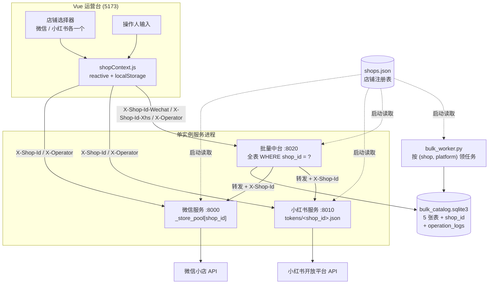
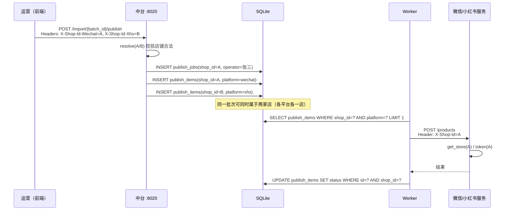

# 多店铺支持方案

| 项目 | 内容 |
| --- | --- |
| 文档版本 | v1.0 |
| 编制日期 | 2026-09-15 |
| 适用范围 | 微信小店服务（8000）、小红书服务（8010）、批量发布中台（8020）、Vue 运营台（5173） |
| 配套文档 | 《多店铺改造清单.md》逐文件施工图、《新增店铺接入SOP.md》运维步骤 |
| 配套模板 | 项目根 `shops.example.json` |
| 交付性质 | 本轮为**方案评审交付**（文档 + 配置模板），不改动任何生产代码 |

> ⚠️ **本文是改造前（2026-09-15）的方案稿，保留原貌不改写。**
> 实际落地与本文的差异（一个 shop 同时含微信+小红书、默认店名、`operation_logs` 与 `ShopPanel` 未实现、P5 工具适配未做等）见 **《多店铺实现现状.md》**（as-built，2026-09-16）。

---

## 一、背景与目标

### 1.1 背景

公司目前同时运营多个店铺，运营提出新增店铺需求。经代码调研，现有系统是**强单店铺架构**：

- 微信、小红书各自只有**一套全局凭证**，代码中不存在任何「店铺 / 账号 / 租户」字段。
- 批量中台的 SQLite 5 张表**全部没有店铺维度**。
- 平台服务地址、品牌、运费模板、图片共享盘目录均为**全局单例或硬编码**。
- 前端只有「一套账号授权」界面，**没有店铺选择器**。

因此「新增一个店铺」在当前架构下**无法通过改配置完成**，必须先做架构改造。

### 1.2 目标

| 目标 | 说明 |
| --- | --- |
| 每平台支持 N 家店 | 不写死 2 家，后续可继续新增，改配置 + 重启即可 |
| 单实例运行时切换 | 三个服务仍各跑一份，靠请求上下文路由凭证与数据，不拆多进程多端口 |
| 数据完全隔离 | 批次、商品、发布任务、发布明细、图片缓存、类目别名按店铺隔离，跨店互不可见 |
| 店铺级参数可配 | 品牌、类目、运费模板、物流方案、售后地址、图片目录随店铺配置 |
| 轻量留痕 | 不做登录鉴权，但关键动作记录操作人 + 店铺 + 时间 |
| 可回滚 | 删除 `shops.json` 即退回现有单店铺行为 |

### 1.3 非目标

- 不做用户登录 / 密码 / JWT / 角色权限体系。
- 不改动货盘标题生成逻辑（`enrich_titles` 及其上方「待办」注释保持原样，运营要求先不改）。
- 不引入新框架、新中间件（不引入 Redis、不引入 Vue Router / Pinia 等）。
- 不做跨店铺的合并统计看板（需要时再单独设计）。

---

## 二、现状评估与难度结论

### 2.1 三类「全局状态」是改造的真正难点

| 类别 | 现状 | 影响 |
| --- | --- | --- |
| **进程内全局客户端单例** | `wechat/fastapi_server.py:77` 的 `store = WxStore(APPID, SECRET)` 被 13 个路由共享；`xhs/xhs_store.py:75-77` 的 `APP_ID/APP_SECRET/ACCESS_TOKEN` 被 `xhs_api.py:69` 导入后全局使用 | 请求无法区分店铺，必然串店 |
| **进程内全局缓存** | 微信 `_CAT_CACHE` / `_CACHE`（`fastapi_server.py:83/85`）；小红书 `_CACHE`（`xhs_api.py:95`） | 商品列表、运费模板、类目、品牌等会跨店串数据 |
| **数据库唯一约束与主键** | `category_aliases.internal_category` 全局唯一；`image_upload_cache` 主键 `(platform, source_hash)` 无店铺 | 两店不能有同名类目别名；图片素材 URL 会跨店复用 |

此外，唯一的授权凭证载体 `xhs/token_store.json` 是**单文件、文件名硬编码**（`xhs/xhs_api.py:74-77`），而 `xhs/xhs_store.py:36-37` 的注释已经写明「一个 token 对应一家店铺，多店铺要各自维护」——即**平台规则本身就要求一店一 token**。

### 2.2 难度结论

> **难度：中等偏高，约 18-23 人天（推荐按 22 人天排期）。**

判断依据：

- **不难在业务逻辑**：没有任何算法/流程要重写，发布链路、货盘转换、类目映射逻辑保持不动。
- **难在横切面广**：需改后端路由 **58 个**、SQL **约 39 条**、`_xhs_call` 调用点 **20 处**、缓存 key **24 处**、跨服务请求 **13 处**、前端 API 调用约 **60 处**。
- **风险集中在「漏改」**：任何一处漏加 `shop_id`，都可能导致**把货发到错误的店铺**，属于线上事故级风险。

**降低风险的关键**：本方案刻意设计了三个「收口注入点」（见 3.4 节），把 58 个路由的改造收敛为 3 个函数 + 模式化替换，避免逐处自由发挥。

---

## 三、目标架构

### 3.1 总体思路

> **一处配置（店铺注册表） + 一个上下文字段（shop_id） + 服务内按 shop_id 路由。**

保持「一个微信服务 + 一个小红书服务 + 一个中台」的进程结构不变，服务地址也不拆分，只是每次请求携带当前店铺 ID。



### 3.2 数据流：一次批量发布的完整链路



### 3.3 核心数据结构

**店铺注册表（`shops.json`）**

```jsonc
{
  "version": 1,
  "default_operator": "运营A",
  "shops": [
    {
      "shop_id": "wechat_diamond_01",     // 全局唯一，小写字母/数字/下划线
      "name": "钻石世家（微信小店）",      // 前端展示名
      "platform": "wechat",               // wechat | xhs
      "enabled": true,                    // false 时前端不展示、Worker 不领任务
      "is_default": true,                 // 每平台最多一个，兜底旧调用
      "credentials": { "appid": "...", "secret": "..." },
      "params": { "brand_id": "...", "freight_template_id": "...", "after_sale_address_id": "..." },
      "image_root": "\\\\192.168.10.250\\...\\SHINING HOUSE培育钻"
    }
  ]
}
```

完整字段说明与示例见项目根 `shops.example.json`。

**新增共享模块 `shop_registry.py`**

| 函数 | 用途 |
| --- | --- |
| `load_and_validate()` | 启动时读 + 校验，非法直接失败（fail fast） |
| `resolve(shop_id, platform=None)` | 请求上下文解析，空值回退该平台默认店 |
| `platform_of(shop_id)` | 由 shop_id 反查平台 |
| `redacted_list()` | 脱敏清单，供 `GET /shops` |

**新增留痕表 `operation_logs`**

```sql
operation_logs(id, shop_id, platform, operator, action, target, detail, created_at)
-- action: switch_shop / import / import_huopai / map_change / publish / retry / scan_images
```

### 3.4 三个「收口注入点」（改造锚点）

| # | 位置 | 现状 | 改造后 |
| --- | --- | --- | --- |
| 1 | `wechat/fastapi_server.py:77` | `store = WxStore(APPID, SECRET)` | `get_store(shop_id)` 从 `_store_pool` 懒加载（`WxStore` 的 token 缓存是实例级，一店一实例天然隔离） |
| 2 | `xhs/xhs_api.py:181` `_xhs_call()` | 内部 188 / 216 行用全局常量构造 `XhsStore` | 加 `shop_id` 参数，凭证在该函数内按店取；**过期重试分支必须带同一 shop_id** |
| 3 | `bulk_api/bulk_api.py:148` `_json_post()` / `:1850` `_http_get_json()` | 无自定义头 | 支持透传 `X-Shop-Id` / `X-Operator`，13 处跨服务调用统一由此发出 |

---

## 四、关键设计决策

### 4.1 为什么用「请求头透传」而不是路由 / 网关

| 方案 | 优点 | 缺点 | 结论 |
| --- | --- | --- | --- |
| 路径前缀（`/api/shops/{shop_id}/...`） | 语义清晰、可用网关分流 | 需改 58 个路由路径 + 前端全部 URL + 代理规则，改动面最大 | ✗ |
| 独立路由层 / 网关 | 解耦彻底 | 引入新组件与运维成本，与「单机单实例」现状不匹配 | ✗ |
| **请求头 `X-Shop-Id`** | 后端只加一个参数、前端只加一个拦截器、服务地址与代理全部不变 | 需要严格约定「不漏传」，靠服务端默认回退兜底 | **✓ 采用** |

### 4.2 为什么不做多进程多端口

用户已明确选择单实例多店铺。技术上也支持这一选择：

- SQLite 单文件在多进程写入下会出现写竞争（虽有 WAL，但多 worker 无协调易重复消费）。
- `bulk_worker.py` 的任务领取**没有租约/去重机制**，多实例会重复发品。
- 前端代理与端口配置会随店铺数线性膨胀。

### 4.3 为什么不用 Redis / 分布式缓存

单机 Windows、单进程，所有缓存（`_CACHE` / `_CAT_CACHE` / `_IMAGE_CACHE_MEM`）按 `shop_id` 分键即可，无需引入外部组件。

### 4.4 批量发布的「双店铺上下文」问题（唯一需要特殊处理的地方）

现有批量发布是**一次请求同时勾选微信 + 小红书**，而两个平台的「当前店铺」可能不同。约定：

- 前端 bulk 请求携带两个头：`X-Shop-Id-Wechat`、`X-Shop-Id-Xhs`。
- 后端 `publish` 接口按 item 的 `platform` 取对应店，分别写入 `shop_id`。
- 若只带单个 `X-Shop-Id`（旧调用），则两平台都用它。

---

## 五、店铺切换机制（核心章节）

### 5.1 选型结论

> **状态管理（前端响应式上下文）+ 请求头透传 + 服务端解析**。
> 不引入 vue-router，不引入 Pinia，不使用 URL 参数。

理由：现有前端是「单页多视图」，靠 `App.vue:33` 的 `activeView = ref('products')` 切换视图（`App.vue:440-448` 菜单驱动），并没有真正的路由系统。为一个「当前店铺」引入路由框架属于过度设计。项目当前**没有任何状态管理库**，用 Vue 自带的 `reactive` 足够。

### 5.2 切换粒度：按平台分别记住

这是本方案最重要的一个设计选择。因为批量发布需要「微信当前店 A + 小红书当前店 B」并存，所以**不能只有一个全局当前店铺**：

```js
// frontend/src/shopContext.js
import { reactive } from 'vue'

export const shopState = reactive({
  shops: [],                        // GET /shops 返回（脱敏）
  current: { wechat: '', xhs: '' }, // 按平台分别记住
  operator: '',
})

export function getShopId(platform) { return shopState.current[platform] || '' }
export function getOperator() { return shopState.operator || '' }
export function setCurrentShop(platform, shopId) {
  shopState.current[platform] = shopId
  localStorage.setItem('shop.current', JSON.stringify(shopState.current))
  notifyChange(platform)            // 触发订阅者重载
}
export function setOperator(name) {
  shopState.operator = name
  localStorage.setItem('shop.operator', name)
}
```

持久化：`localStorage` 键 `shop.current` / `shop.operator`（项目此前 0 处使用 storage，属纯新增）。

### 5.3 透传：三个 axios 实例各加一个请求拦截器

| 实例 | 文件 | 注入头 |
| --- | --- | --- |
| `storeApi` | `frontend/src/api.js:3-8` | `X-Shop-Id: getShopId('wechat')`、`X-Operator` |
| `xhsApi` | `frontend/src/xhsApi.js:3-6` | `X-Shop-Id: getShopId('xhs')`、`X-Operator` |
| `bulkApi` | `frontend/src/bulkApi.js:3` | `X-Shop-Id-Wechat`、`X-Shop-Id-Xhs`、`X-Operator` |

```js
http.interceptors.request.use((config) => {
  config.headers['X-Shop-Id'] = getShopId('wechat')
  config.headers['X-Operator'] = getOperator()
  return config
})
```

> 关键：**调用点零改动**。58 个后端路由与约 60 处前端调用都靠拦截器与后端解析自动生效，这是把改动面压到最小的核心手段。

### 5.4 服务端解析与兜底

```python
def resolve(shop_id: str | None, platform: str | None = None) -> dict:
    if not shop_id:
        return default_shop(platform)          # 未传 → 该平台默认店（兼容旧脚本）
    shop = get_shop(shop_id)
    if shop is None:
        raise HTTPException(400, f"未知店铺: {shop_id}")
    if platform and shop["platform"] != platform:
        raise HTTPException(400, f"店铺 {shop_id} 不属于平台 {platform}")
    if not shop.get("enabled"):
        raise HTTPException(400, f"店铺 {shop_id} 已停用")
    return shop
```

三层防护：**平台校验 → 启用状态校验 → 默认回退**。

### 5.5 切换后的界面重载

| 组件 | 需要重载/清空的内容 |
| --- | --- |
| `App.vue` | `productPageCache`（203 行）、商品列表、统计、健康状态 |
| `BulkPublishPanel.vue` | `batch`(37)、`mapping`(39)、`publishStatus`(152)、`currentJob`(97)、`platformSettings`(50)、`imageScanResult`(33)、`imageRootOptions`(27)、`huopaiFiles`(31)、`xhsCascade`(42)、`selectedProductCodes`(254) |
| `XhsProductPanel.vue` | 商品列表 |
| `CategoryAliasPanel.vue` | 别名列表 |
| `ShopPanel.vue`（新增） | 店铺清单与各店 token 状态 |

实现方式：`shopContext` 维护一个订阅回调列表，组件 `onMounted` 时订阅、`onUnmounted` 时取消；切换店铺时统一触发重载。

**必要的一次确认**：若当前有未保存的发品表单或正在进行的发布任务，切店前弹一次确认框，避免操作丢失。

### 5.6 Worker 的店铺路由

`bulk_worker.py:30-35` 现在按 `for platform in ("wechat","xhs")` 各起 6 线程。改造后：

```python
for shop in enabled_shops():          # 遍历启用店铺
    for index in range(worker_count):
        Thread(target=_worker_loop, args=(shop["shop_id"], shop["platform"]))
```

`_worker_loop` 的领任务 SQL（`bulk_api.py:593/595`）加 `AND shop_id = ?`，确保线程只领本店任务。

> **注意**：店铺数增加后并发线程数 = 店铺数 × 6。4 家店即 48 线程同时打平台接口，需按平台侧 QPS 限流（见风险 4.4）。

### 5.7 切换机制的兜底与可观测

- 服务端每个响应可回带 `X-Shop-Id-Resolved`（实际解析到的店铺），便于排障。
- 前端顶栏常显「当前店铺」，避免运营在错误店铺下操作。
- 发布前二次校验 item 归属（`item.shop_id == job.shop_id`），不匹配直接失败，这是防串店的最后一道闸。

---

## 六、数据隔离策略

### 6.1 隔离层次

| 层次 | 策略 |
| --- | --- |
| 数据库 | 同库（`bulk_catalog.sqlite3`）+ 全表 `shop_id` 列；所有查询强制 `WHERE shop_id = ?` |
| 唯一约束 | `category_aliases`：`UNIQUE(shop_id, internal_category)`；`image_upload_cache`：`PRIMARY KEY(shop_id, platform, source_hash)` |
| 索引 | worker 领取索引、发布状态索引均前置 `shop_id`（否则会领到别店任务） |
| 图片 | 图片上传缓存按店隔离；共享盘根目录按店配置；白名单为各店 root 并集并做归属校验 |
| 内存缓存 | 微信 14 处 / 小红书 10 处 key 全部前置 `shop_id` |
| 凭证 | 微信一店一 `WxStore` 实例；小红书一店一个 `xhs/tokens/<shop_id>.json` |
| 同步链路 | `guanyi_sync.py` 的映射文件与增量游标按店铺分文件 |

### 6.2 隔离表改造一览

| 表 | 改造方式 | 关键点 |
| --- | --- | --- |
| `batches` | `ALTER TABLE ADD COLUMN shop_id` + `operator` | 历史数据回填默认店 |
| `publish_jobs` | 同上 | 一个 job 只属一店 |
| `publish_items` | `ADD COLUMN shop_id`（冗余） | 领任务 SQL 必须带 shop_id |
| `category_aliases` | **重建表** | `UNIQUE(shop_id, internal_category)` |
| `image_upload_cache` | **重建表** | `PRIMARY KEY(shop_id, platform, source_hash)`，**图片不串店的关键** |
| `operation_logs` | 新建 | 留痕 |

### 6.3 历史数据迁移

- 新增幂等函数 `_migrate_shops(conn)`，在 `db()` 内调用；通过 `PRAGMA table_info(batches)` 是否含 `shop_id` 判断是否已迁移。
- **迁移前自动备份**：`PRAGMA wal_checkpoint(TRUNCATE)` 后复制 `bulk_catalog.sqlite3` 为 `bulk_catalog.backup_<时间戳>.sqlite3`。
- 需改唯一约束的两张表用「建新表 → 拷数据 → 删旧表 → 改名」，全程在事务内，并校验迁移前后行数一致，不一致则回滚。
- 全部历史数据回填**默认店铺 `diamond-house`**。
- 数据库文件本身受 `.gitignore:28-31` 保护，不会被提交。

> **默认店铺 ID 必须与 `runtime_config.load_shops()` 单店回退时的 `shop_id` 一致**，否则历史数据在新架构下「查不到」。

详细 SQL 与迁移伪代码见《多店铺改造清单.md》第 4.1 节。

---

## 七、权限控制与留痕

### 7.1 策略：不做登录，只做留痕

用户已确认采用轻量方案。本项目当前**完全没有用户/登录/鉴权代码**（无 JWT、无 session、无中间件），引入完整账号体系属于新增子系统，成本远高于本次改造本身，故不在本次范围。

### 7.2 操作人来源与传递

1. 前端顶栏提供「操作人」输入框，默认值取 `shops.json` 的 `default_operator`。
2. 写入 `localStorage` 的 `shop.operator`，刷新后保留。
3. 所有请求经拦截器带 `X-Operator` 头。
4. 后端从请求头取值，为空时记为 `unknown`（不阻断操作）。

### 7.3 留痕范围

| 动作 | 记录字段 |
| --- | --- |
| 切换店铺 | `action=switch_shop`、`shop_id`、`operator` |
| Excel 导入 | `action=import`、`target=batch_id` |
| 货盘导入 | `action=import_huopai`、`target=batch_id`、`detail={path}` |
| 类目映射变更 | `action=map_change`、`target=batch_id` |
| 发起发布 | `action=publish`、`target=job_id`、`detail={platforms, product_codes}` |
| 失败重试 | `action=retry`、`target=job_id`、`detail={item_ids}` |
| 图片扫描 | `action=scan_images`、`target=batch_id`、`detail={root, months}` |

此外 `batches.operator` 与 `publish_jobs.operator` 冗余记录，便于直接按人/按店追溯「谁发的、发给哪家店」。

### 7.4 留痕的边界与说明

- 留痕是**追溯手段**，不是**访问控制**：任何人都可以切换任意店铺，符合当前运营团队规模与信任模型。
- 若后续需要真实权限，可在 `shop_registry.resolve()` 内加一层「用户-店铺映射」校验，架构无需改动（这是把权限预留在了收口点上）。

---

## 八、改造点总览

改造点已逐文件、逐函数列在《多店铺改造清单.md》，此处仅汇总：

| 模块 | 路由 | SQL | 调用点 | 参考章节 |
| --- | --- | --- | --- | --- |
| 共享配置层 | — | — | 32 个配置键 | 清单 §1 |
| 微信服务 | 13 | 0 | `store` 13 处 + 缓存 14 处 | 清单 §2 |
| 小红书服务 | 20 | 0 | `_xhs_call` 20 处 + token 12 处 + 缓存 10 处 | 清单 §3 |
| 批量中台 | 25 | 约 39 条 | 跨服务请求 13 处 + Worker | 清单 §4 |
| 前端 | — | — | 3 实例 + 7 个组件 + 约 60 处调用 | 清单 §5 |
| 工具脚本 | — | — | 凭证 5 处 + 品牌 2 处（标题逻辑禁改） | 清单 §6 |
| **合计** | **58** | **约 39** | **约 120 处** | — |

---

## 九、新增店铺接入步骤（摘要）

完整可操作步骤（含排查手册）见《新增店铺接入SOP.md》，七步摘要：

1. **准备资质**：微信小店 AppID/Secret；小红书 appId/appSecret，并按店完成一次主账号授权拿 `code`。
2. **写配置**：在 `shops.json` 追加店铺块（`enabled=false`），填凭证、平台参数、图片目录。
3. **重启服务**：`python fastapi_server.py` / `python xhs_api.py` / `python bulk_api.py`（无 `--reload`，必须重启）。
4. **完成授权**：调该店 `/token/code` 提交 code，`/token/info?shop_id=` 确认有效期。
5. **连通验证**：`GET /shops` 可见新店；前端选择器可切换；微信 `/token/test` 通过。
6. **试发布**：导入小批次，仅发 1-2 个商品草稿，核对标题 / 类目 / 运费 / 图片归属。
7. **正式上线**：`enabled=true` + 重启，批量发布并观察失败清单。

---

## 十、工作量预估

### 10.1 分阶段 WBS

| 阶段 | 内容 | 主要产出 | 人天 |
| --- | --- | --- | --- |
| P0 | 店铺注册表 + `runtime_config` 扩展 + `shop_registry.py` + 配置模板 | 配置层可用，单店回退可验证 | 2 |
| P1 | 中台：表结构 `shop_id`、迁移函数、留痕表、25 路由、39 条 SQL、转发透传 | 中台多店铺可用 | 5 |
| P2 | 微信服务：`_store_pool` + 13 路由 + 缓存分键 + 店铺参数下沉 | 微信多店铺可用 | 3 |
| P3 | 小红书服务：token 分文件 + `_xhs_call` + 20 路由 + 缓存分键 + `guanyi_sync` | 小红书多店铺可用 | 3 |
| P4 | 前端：`shopContext` + 3 拦截器 + 选择器 + 操作人 + `ShopPanel` + 切店重载 | 运营可切换店铺 | 4 |
| P5 | 工具适配：`upload_images` 按店输出、`huopai_adapter` 品牌与图片路径（**标题逻辑不动**） | 工具链一致 | 2 |
| P6 | 联调 + 迁移演练 + 回归测试 + SOP 落地 | 可上线 | 3 |
| — | **合计** | — | **22 人天** |

### 10.2 排期建议

| 人员配置 | 预计周期 |
| --- | --- |
| 1 人（含联调） | 约 4-5 周 |
| 2 人并行（后端 / 前端拆分，P1 与 P2+P3 可并行） | 约 2-3 周 |

### 10.3 关键路径

`P0 → P1 →（P2 ‖ P3）→ P4 → P6`。其中 **P1（中台）是关键路径最长项**，也是风险最集中项，建议优先开工并由最熟悉 `bulk_api.py` 的人负责。

### 10.4 人力与技能要求

| 角色 | 技能 | 投入 |
| --- | --- | --- |
| 后端 A | FastAPI + sqlite3 + 现有 bulk 链路 | P0/P1，约 7 人天 |
| 后端 B | FastAPI + 微信/小红书客户端 | P2/P3，约 6 人天 |
| 前端 | Vue3 + Element Plus + axios | P4，约 4 人天 |
| 测试/运维 | 平台授权、发布验证 | P6，约 3 人天 |

---

## 十一、风险与缓解

| # | 风险 | 等级 | 影响 | 缓解措施 |
| --- | --- | --- | --- | --- |
| 1 | **Token 串号 / 发错店铺** | 🔴 极高 | 商品上到错误店铺，需平台侧下架善后 | 强制 `X-Shop-Id` 透传；`_xhs_call` 过期重试分支带同一 shop_id；发布前校验 `item.shop_id == job.shop_id`；单测覆盖 `get_store` / `_xhs_call` 的店铺解析 |
| 2 | 历史数据迁移失败 | 🟠 高 | 批次/发布记录丢失 | 迁移前自动备份 + 副本库演练 + 幂等可重跑 + 事务内行数校验 |
| 3 | 唯一约束重建出错 | 🟠 高 | 别名/图片缓存表损坏 | 仅两张表需重建，事务内完成 + 前后 `COUNT(*)` 比对 + 失败回滚 |
| 4 | **Worker 跨店领任务 / 并发过高** | 🔴 极高 | 串店发货；平台限流导致批量失败率上升 | 领任务 SQL 强制 `shop_id`；线程名带 shop_id；按 `BULK_WORKERS_PER_SHOP` 控制总线程数，4 店时需重新评估限流 |
| 5 | 平台参数配错（品牌/类目/运费/物流/售后） | 🟠 高 | 发品失败或信息错误 | 接入 SOP 逐项验证清单 + 试发布草稿确认 |
| 6 | 图片目录 / 素材空间串店 | 🟠 高 | 图片版权与展示错误 | `image_upload_cache` 按店主键；白名单为并集并做归属校验；小红书素材空间天然按店隔离（不隔离会直接复用错链接） |
| 7 | 多店 token 独立到期 | 🟡 中 | 某店突然无法发品 | `ShopPanel` 集中展示各店 token 剩余；运维按店巡检 `/token/info` |
| 8 | 前端切店脏数据 | 🟡 中 | 看到别店商品/批次，误操作 | 所有面板 watch 切店强制重载；清空 `productPageCache`；禁止跨店缓存 |
| 9 | 改动面广导致回归 | 🟠 高 | 现有单店功能被改坏 | 分阶段合并；P0 起保留「无 `shops.json` 即退回现状」；每阶段跑回归 |
| 10 | 运营约定不得改动 | — | 触发返工 | 标题逻辑（`enrich_titles` 及三个待选方案）保持原样，本次只做店铺维度配置化 |
| 11 | 平台限流 / QPS 变化 | 🟡 中 | 批量发布失败率上升 | 发布前小批量试跑；按平台观察失败率动态调线程数 |
| 12 | 数据库锁竞争加剧 | 🟡 中 | `database is locked` | 已启用 WAL + `busy_timeout=30000`；店铺增多后控制 worker 总量 |

---

## 十二、实施路线与回滚

### 12.1 实施阶段

| 阶段 | 交付 | 可独立验证 | 可回滚方式 |
| --- | --- | --- | --- |
| M0 | 文档 + `shops.example.json` | — | — |
| M1 | 配置层（P0） | 无 `shops.json` 时行为不变 | 删除 `shop_registry.py` 相关改动 |
| M2 | 中台改造（P1） | 单店下全部接口回归通过 | 恢复备份数据库 + 回退代码 |
| M3 | 平台服务改造（P2/P3） | 单店发品链路回归通过 | 回退服务代码 |
| M4 | 前端改造（P4） | 单店界面功能不变 | 回退前端 |
| M5 | 工具适配（P5） | 货盘转换结果一致 | 回退脚本 |
| M6 | 新店接入（P6） | 试发布通过 | 删除新店配置块 + 重启 |

### 12.2 回滚总闸

> **删除项目根 `shops.json` 并重启三个服务**，系统即回到单店铺模式（`runtime_config` 用 env 合成默认店 `diamond-house`）。

数据库层面保留了 `shop_id` 列（不回删，SQLite 删列代价高且无必要），但单店模式下所有查询都命中默认店，行为与改造前等价。

---

## 十三、交付物清单

| 文件 | 类型 | 说明 |
| --- | --- | --- |
| `docs/多店铺支持方案.md` | 文档 | 本文档：评估、架构、切换机制、隔离、权限、工作量、风险 |
| `docs/多店铺改造清单.md` | 文档 | 逐文件逐函数施工图（58 路由 / 39 SQL / 前端与工具） |
| `docs/新增店铺接入SOP.md` | 文档 | 可操作接入步骤 + 排查手册 |
| `shops.example.json` | 模板 | 店铺注册表模板（脱敏），复制为 `shops.json` 使用 |
| `shops.json` | 配置 | **部署时创建，需加入 `.gitignore`，本次不提供真实文件** |

需补充到 `.gitignore` 的规则：`shops.json`、`xhs/tokens/`、`uploaded_images_*.json`、`uploaded_images_*.txt`。

---

## 附录 A：术语表

| 术语 | 说明 |
| --- | --- |
| 店铺 / shop | 一个平台上的一个商家账号（微信小店或小红书店铺） |
| `shop_id` | 店铺唯一标识，如 `xhs_diamond_02` |
| 默认店 | 每平台一个，用于兜底未带 `X-Shop-Id` 的调用 |
| 收口注入点 | 改造爆炸半径最小的三个函数/实例化位置 |
| 单店回退 | 无 `shops.json` 时自动合成默认店，行为等同改造前 |

## 附录 B：相关代码位置速查

| 位置 | 说明 |
| --- | --- |
| `wechat/fastapi_server.py:58-59,77` | 微信全局凭证与单例 |
| `wechat/wechat_store_client.py:72-82` | `WxStore` 实例级 token 缓存 |
| `xhs/xhs_api.py:74-77,95,128-229,250-323` | 小红书 token 文件、缓存、`_xhs_call`、token 接口 |
| `xhs/xhs_store.py:75-77` | 小红书模块级凭证常量 |
| `bulk_api/bulk_api.py:34-44,102-145,217,1846-1847` | DB 路径、表结构、品牌兜底、平台地址 |
| `bulk_api/bulk_api.py:542-564` | `_run_publish_item`（串店最高危点） |
| `bulk_api/bulk_worker.py:29-35` | worker 线程结构 |
| `frontend/src/api.js:3-8` / `xhsApi.js:3-6` / `bulkApi.js:3` | 三个 axios 实例 |
| `frontend/src/App.vue:33,203,440-448,456-465,560-585` | 视图切换、页面缓存、菜单、顶栏、授权区 |
| `frontend/vite.config.js:10-26` | 代理（本次无需改动） |
| `runtime_config.py:7-18,57-59` | 配置白名单与加载入口 |
| `huopai_adapter.py:361` | **`enrich_titles`：本次禁止改动** |
