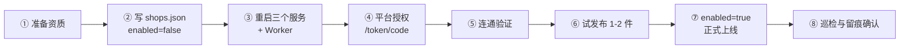

# 新增店铺接入 SOP

> 适用前提：多店铺改造已完成并上线（架构与决策见《多店铺支持方案.md》，实际落地结构见《多店铺实现现状.md》）。
> 本文档描述**新增一家店铺**的完整操作步骤，目标是把「配置 → 授权 → 验证 → 试发布 → 上线」跑成一条可复制的流水线。
> 环境：Windows + PowerShell；服务端口 8000（微信）/ 8010（小红书）/ 8020（中台）/ 5173（前端）。
>
> **核心概念**：一个 `shop` = 一个运营单元（品牌/店铺组），**同时含微信 + 小红书两套配置**，不是一平台一店。
> `shop_id` 用品牌名的拼音全拼（如 `zuanshishijia`、`xianluodingzhi`），只用小写字母/数字/下划线，
> 启用后**不要改**（数据库、token 文件、上传结果文件都按它归档）。

---

## 0. 全流程一览



预计耗时：

| 平台 | 纯操作时长 | 主要等待项 |
| --- | --- | --- |
| 微信小店 | 30-60 分钟 | 类目权限、运费模板创建 |
| 小红书 | 40-90 分钟 | 主账号授权、品牌/类目/物流方案确认 |

---

## 1. 步骤一：准备平台资质

### 1.1 需要向平台申请/确认的信息

| 平台 | 字段 | 从哪里拿 | 备注 |
| --- | --- | --- | --- |
| 微信小店 | `appid` | 微信小店后台 → 服务市场/自研应用 | 形如 `wx...` |
| 微信小店 | `secret` | 同上 | 只显示一次，注意保存 |
| 微信小店 | `freight_template_id` | 后台 → 运费模板 | 每店不同 |
| 微信小店 | `after_sale_address_id` | 后台 → 售后地址 | 每店不同 |
| 微信小店 | `brand_id` | 后台 → 品牌库 | 无品牌时用 `2100000000` 占位 |
| 小红书 | `app_id` / `app_secret` | 小红书开放平台 → 应用管理 | 一店一套应用凭证 |
| 小红书 | `auth code` | 店铺主账号登录授权后从回调地址取 | **10 分钟有效**，过期需重新授权 |
| 小红书 | `brand_id` | 开放平台 → 品牌查询 | 建议先用 `/brands` 接口确认 |
| 小红书 | `category_id` | 开放平台 → 类目查询 | 叶子类目 |
| 小红书 | `shipping_template_id` | 后台 → 运费模板 | 每店不同 |
| 小红书 | `logistics_plan_id` | 后台 → 物流方案 | 每店不同 |
| 通用 | `image_root` | 共享盘目录 | 形如 `\\192.168.10.250\...\店铺名` |

### 1.2 授权链接（小红书）

浏览器用**店铺主账号**打开：

```
https://ark.xiaohongshu.com/ark/authorization?appId=<该店的app_id>&redirectUri=<回调地址>&state=<任意值>
```

授权成功后从回调地址复制 `code` 参数，进入步骤四。

### 1.3 shop_id 命名

规则：`^[a-z0-9_]+$`，全局唯一，**一旦启用不可改名**（数据库、token 文件、图片上传结果都按它归档）。

推荐格式：用品牌/店铺的中文拼音全拼，不要带平台词（`xhs_`/`wx_` 前缀），不要用序号。

| 示例 | 含义 |
| --- | --- |
| `zuanshishijia` | 钻石世家（默认店，微信 + 小红书） |
| `xianshangmaodedian` | 喜安商贸的店（小红书店） |
| `xianluodingzhi` | 喜安裸钻定制（微信店） |
| `mouzhubao` | 某珠宝（未来新增品牌） |

命名由**运营给中文名**，技术转拼音；避免重名时在末尾加后缀（如 `zuanshishijia_2`）。

---

## 2. 步骤二：写入店铺注册表

1. 若项目根还没有 `shops.json`，先复制模板：

```powershell
Copy-Item shops.example.json shops.json
```

2. 在 `shops.json` 的 `shops` 数组追加新店铺块，**先设为 `enabled: false`**：

```json
{
  "shop_id": "dianmingpinyin",
  "name": "店铺中文名",
  "enabled": false,
  "is_default": false,
  "wechat": {
    "appid": "${WX_APPID_DIANMING}",
    "secret": "${WX_SECRET_DIANMING}",
    "brand_id": "",
    "freight_template_id": "",
    "after_sale_address_id": ""
  },
  "xhs": {
    "app_id": "${XHS_APP_ID_DIANMING}",
    "app_secret": "${XHS_APP_SECRET_DIANMING}",
    "access_token": "",
    "refresh_token": "",
    "brand_id": "",
    "category_id": "",
    "shipping_template_id": "",
    "logistics_plan_id": ""
  },
  "image_root": "\\\\192.168.10.250\\电子商务部\\网销部共享\\店铺名",
  "remark": "店铺后台名 + 归属验证锚点商品ID"
}
```

规则说明：
- 密钥一律写 `${环境变量名}` 占位，真值放在 `.env` 或 Windows 用户环境变量（各店前缀不同，如 `WX_APPID_XIANLUODINGZHI`）。
- `access_token` / `refresh_token` 留空 —— 首次授权后自动写入 `xhs/tokens/<shop_id>.json`，不放在这里。
- `wechat` / `xhs` 缺哪个平台就把那段留空（`{}`），表示该店未配置此平台。
- `enabled: false` 时前端选择器不显示、worker 不领它的任务，**可以先完成授权**再启用。

3. 必须遵守的校验规则（不符合会**启动即失败**）：

- `shop_id` 唯一、符合命名规则（小写字母/数字/下划线）；
- `is_default` 全局最多一个；
- 启用的店铺至少有一个平台配置了 `appid` / `app_id`。

4. 安全要求：

```powershell
# shops.json 含真实密钥，确认已被忽略
git check-ignore -v shops.json
```

若未被忽略，把 `shops.json` 加入 `.gitignore`（连同 `xhs/tokens/`）。

---

## 3. 步骤三：重启服务

> 三个服务均**无 `--reload`**，改配置/改后端**必须重启**才生效。

### 3.1 接口服务（各开一个终端，在各自目录启动）

```powershell
# 1) 微信小店服务 :8000
cd wechat
python fastapi_server.py

# 2) 小红书服务 :8010
cd xhs
python xhs_api.py

# 3) 批量中台接口 :8020
cd bulk_api
python bulk_api.py
```

### 3.2 发布 Worker

Worker 以 Windows 计划任务 `EcommerceBulkWorker` 运行（`SYSTEM` 账号、开机自启），由 `bulk_api/install_worker_autostart.ps1` 创建。

```powershell
# 查看任务状态
Get-ScheduledTask -TaskName EcommerceBulkWorker | Select-Object TaskName, State

# 重启（配置变更后必须）
Stop-ScheduledTask  -TaskName EcommerceBulkWorker
Start-ScheduledTask -TaskName EcommerceBulkWorker
```

若为手工终端启动，则关闭旧进程后重新执行：

```powershell
cd bulk_api
python bulk_worker.py
```

> Worker 有单实例互斥（`bulk_worker.py:11-18`），重复启动会直接退出，属预期行为。

### 3.3 前端（仅在改动前端代码时需要）

```powershell
cd frontend
npm run dev
```

### 3.4 启动自检

```powershell
# 三个服务健康检查
curl.exe http://127.0.0.1:8000/health
curl.exe http://127.0.0.1:8010/health
curl.exe http://127.0.0.1:8020/health

# 店铺清单（应能看到新店，且不含任何密钥字段）
curl.exe http://127.0.0.1:8020/shops
```

若启动失败，服务日志会直接给出校验错误（如 `shop_id 重复`、`凭证缺失`），按提示修正 `shops.json` 后重启即可。

---

## 4. 步骤四：平台授权

### 4.1 小红书：用 code 换 token

```powershell
# 新店授权（shop_id 通过 header 传；code 10 分钟内有效）
curl.exe -X POST http://127.0.0.1:8010/token/code `
  -H "Content-Type: application/json" `
  -H "X-Shop-Id: dianmingpinyin" `
  -d "{\"code\":\"粘贴回调里的code\"}"
```

成功返回 `accessToken` / `refreshToken` / `expireAt`，并写入 `xhs/tokens/dianmingpinyin.json`（**一店一文件，互不覆盖**）。

### 4.2 代码成功后勾选 `enabled`

把 `shops.json` 中该店改为 `"enabled": true`，然后**再次重启三个服务与 Worker**（步骤三）。

> 顺序很重要：若先 `enabled=true` 再授权，前端会短暂出现一家「没有 token 的店」，运营点击会报鉴权错误。

### 4.3 微信：无需单独授权

微信服务用 `appid` + `secret` 自动换取 `access_token`（内存缓存，按店铺实例隔离），只要凭证正确即可。

---

## 5. 步骤五：连通验证

### 5.1 逐个接口验证

```powershell
# 1) 店铺清单包含新店，且字段已脱敏（无 secret/token）
curl.exe http://127.0.0.1:8020/shops

# 2) 微信凭证有效性（指定店铺）
curl.exe -X POST http://127.0.0.1:8000/token/test -H "X-Shop-Id: zuanshishijia"

# 3) 小红书 token 状态与剩余有效期
curl.exe "http://127.0.0.1:8010/token/info?shop_id=zuanshishijia"

# 4) 小红书：类目（验证店铺凭证真的通了）
curl.exe "http://127.0.0.1:8010/categories" -H "X-Shop-Id: zuanshishijia"

# 5) 小红书：品牌 / 运费模板 / 物流方案
curl.exe "http://127.0.0.1:8010/brands" -H "X-Shop-Id: zuanshishijia"
curl.exe "http://127.0.0.1:8010/shipping-templates" -H "X-Shop-Id: zuanshishijia"
curl.exe "http://127.0.0.1:8010/logistics-plans" -H "X-Shop-Id: zuanshishijia"

# 6) 中台：图片根目录（应只看到该店配置的目录）
curl.exe http://127.0.0.1:8020/image-roots -H "X-Shop-Id: zuanshishijia"
```

### 5.2 前端验证

1. 打开 `http://localhost:5173`，顶栏店铺选择器出现新店。
2. 切换到新店后，商品列表 / 批次 / 发布状态**全部清空重载**（不应残留上一家店的数据）。
3. 切换回原店，原数据完好。
4. 刷新浏览器，仍记住上次选择的店铺与操作人。

### 5.3 隔离验证（强烈建议）

| 验证项 | 期望 |
| --- | --- |
| 用 A 店 `X-Shop-Id` 读 B 店的 `batch_id` | 返回 404 |
| 两店各存一个同名 `internal_category` 别名 | 互不覆盖 |
| 同一张图片在两店分别上传 | 生成两条缓存记录，URL 各不相同 |
| `/publish-status` | 只返回当前店记录 |
| `DELETE /image-cache` | 只清当前店缓存 |

---

## 6. 步骤六：试发布

1. 导入一个**小批次**（3-5 个商品），或直接用货盘小样。
2. 只勾选 **1-2 个商品**，先发**草稿/不上架**。
3. 逐项核对：

| 核对项 | 检查方式 |
| --- | --- |
| 商品出现在**正确的店铺后台** | 登录该平台后台查看草稿 |
| 标题正确且未被改动 | 与货盘转换预览一致（标题逻辑本次未改） |
| 类目 / 品牌 / 运费模板 / 物流方案 | 与 `shops.json` 中该店 `params` 一致 |
| 图片归属 | 图片 URL 属于该店素材空间，且能正常显示 |
| SKU / 价格 / 库存 | 与货盘一致 |
| 发布记录归属 | 中台「发布状态」只在对应店可见 |

4. **反向验证**：确认原店铺的发布状态里**没有**出现这次试发布的记录。

---

## 7. 步骤七：正式上线

1. 确认试发布无问题后，`enabled` 已为 `true`，服务已重启。
2. 正式批量发布，观察：
   - 失败清单是否按店隔离；
   - Worker 日志中线程名是否带新店 `shop_id`；
   - 平台侧失败率是否正常（若明显上升，见排查手册 §9.6 限流）。
3. 通知运营：新店已在选择器中可选。

---

## 8. 步骤八：巡检与留痕确认

### 8.1 留痕现状

> ⚠️ `operation_logs` 表（切店/导入/发布/重试/改映射 全动作留痕）**尚未实现**。
> 当前留痕只覆盖：
> - `batches.shop_id` + `batches.operator`（谁在哪家店导入了哪个批次）
> - `publish_jobs.shop_id` + `publish_jobs.operator`（谁在哪家店发了哪个任务）
>
> 需要时可直接查 SQLite：
> ```powershell
> sqlite3 bulk_api/bulk_catalog.sqlite3 "SELECT shop_id,operator,id FROM batches ORDER BY created_at DESC LIMIT 10;"
> ```

### 8.2 日常巡检建议

### 8.2 日常巡检建议

| 频率 | 动作 | 命令/位置 |
| --- | --- | --- |
| 每周 | 检查各店 token 剩余有效期 | 前端「店铺管理」页；或 `curl.exe "http://127.0.0.1:8010/token/info?shop_id=<id>"` |
| 每周 | 确认 `refreshToken` 未过期（14 天） | 同上；剩余过长时会提示「剩余>30分钟不换发新 token」属正常 |
| 每月 | 复核 `shops.json` 与平台参数 | 品牌/类目/运费/物流是否有变更 |
| 变更后 | 重启服务与 Worker | 见步骤三 |

> **小红书 token 规则**：`accessToken` 7 天、`refreshToken` 14 天，14 天内至少续期一次，否则需重新走一遍主账号授权。

---

## 9. 排查手册

### 9.1 服务启动失败，提示店铺配置错误

**原因**：`shops.json` 未通过校验（`shop_id` 重复 / 平台非法 / 每平台多个 `is_default` / `enabled` 店铺缺凭证）。
**处理**：按日志提示修正后重启。这是**刻意设计的 fail fast**，避免带着半配置运行。

### 9.2 新店不出现在前端选择器

| 可能原因 | 处理 |
| --- | --- |
| `enabled` 仍为 `false` | 改为 `true` 并重启 |
| 服务未重启 | 重启 8000/8010/8020 与 Worker |
| `GET /shops` 本身报错 | 查看中台日志 |

### 9.3 接口报「未知店铺 / 店铺不属于该平台」

**原因**：`X-Shop-Id` 拼写错误，或把微信店铺 ID 传给了小红书服务（或不带 `X-Shop-Id` 且该平台无默认店）。
**处理**：确认 `shop_id` 与 `platform` 匹配；确认每平台有 `is_default`。

### 9.4 小红书报鉴权失败 / token 过期且自动刷新失败

| 可能原因 | 处理 |
| --- | --- |
| 未完成授权（无 token 文件） | 回到步骤四，用 code 换 token |
| `refreshToken` 超过 14 天 | 只能重新走主账号授权 |
| 该店 `app_secret` 配错 | 核对开放平台应用凭证 |

### 9.5 图片扫描不到 / 预览 404

| 可能原因 | 处理 |
| --- | --- |
| `image_root` 配错或不存在 | 在服务器上直接 `Test-Path` 该 UNC 路径 |
| 服务账号无权访问共享盘 | 用运行服务的账号访问一次该目录 |
| 根目录不在该店白名单 | 确认 `image_root` 已写入该店配置并重启 |

### 9.6 批量发布失败率明显上升

**原因**：店铺数量增加后并发线程数上升（线程数 = 店铺数 × `BULK_WORKERS_PER_PLATFORM`），触发平台限流。
**处理**：

```powershell
# 降低每店每平台并发（改后需重启 Worker）
# 默认 BULK_WORKERS_PER_SHOP = 6，总线程数 = 启用店数 × 平台数 × 每店每平台线程数
$env:BULK_WORKERS_PER_SHOP = "3"
```

然后重启 Worker，并观察失败率恢复情况。

### 9.7 前端切店后仍看到上一家店的数据

**原因**：某组件未订阅切店事件（改造遗漏）。
**处理**：对照《多店铺改造清单.md》§5.5 检查该组件的 `watch`；必要时强制刷新页面并记录为缺陷。

### 9.8 发布记录串店（最高危）

现象：A 店后台出现本应发往 B 店的商品。
**立即处理**：

1. 暂停 Worker（`Stop-ScheduledTask -TaskName EcommerceBulkWorker`）。
2. 在平台后台下架/删除误发商品。
3. 排查 `publish_items.shop_id` 与其 `job_id` 对应 `publish_jobs.shop_id` 是否一致。
4. 确认 `_run_publish_item` 的归属二次校验、`_worker_loop` 领任务 SQL 的 `shop_id` 条件是否生效。
5. 修复并回归测试后再恢复 Worker。

---

## 10. 回滚单店接入

若新店接入后决定放弃：

1. 在 `shops.json` 中删除该店铺块（或把 `enabled` 改为 `false`）。
2. 重启三个服务与 Worker。
3. 该店数据（批次、任务）不会再出现在前端；如需彻底清理，另行按 `shop_id` 归档删除。

> **整体回滚（回到改造前的单店铺模式）**：删除项目根 `shops.json` 并重启全部服务，系统会自动用 `.env` 中的 `WX_*` / `XHS_*` 合成默认店铺 `shop_id = "default"`，行为与改造前完全一致。

---

## 11. 上线检查表（可打印勾选）

**接入前**

- [ ] 平台资质齐全（微信 appid/secret；小红书 app_id/app_secret）
- [ ] 运费模板 / 售后地址 / 品牌 / 类目 / 物流方案 ID 已确认
- [ ] 图片共享盘目录已创建且服务账号可读
- [ ] `shop_id` 命名符合规范且全局唯一
- [ ] `shops.json` 已确认被 git 忽略

**配置与启动**

- [ ] 新店块已写入且 `enabled=false`
- [ ] 三个服务 + Worker 已重启
- [ ] `GET /shops` 可见新店且无密钥字段
- [ ] 服务启动无校验错误

**授权**

- [ ] 小红书 `/token/code` 授权成功，`/token/info` 显示有效期正常
- [ ] 微信 `/token/test` 通过
- [ ] `enabled` 已改 `true` 并再次重启

**验证**

- [ ] 前端选择器出现新店且可切换
- [ ] 切店后数据全部重载，无脏数据
- [ ] 隔离验证（跨店读 404 / 别名不覆盖 / 图片不串）
- [ ] 试发布 1-2 件，平台后台归属正确
- [ ] 原店铺发布状态未受污染

**上线与留痕**

- [ ] 正式批量发布，失败率正常
- [ ] `batches.operator` / `publish_jobs.operator` 与操作人一致
- [ ] 已通知运营新店可用
- [ ] 已加入每周 token 巡检
