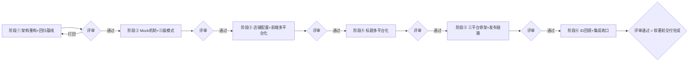

# 抖音 / 京东 / 天猫 适配层实施方案

> 依据：《新平台接口清单（抖音·京东·天猫）.md》
> 配套现状文档：《多店铺实现现状.md》《多店铺改造清单.md》《新增店铺接入SOP.md》
> 编写日期：2026-10-09

---

## 0. 一句话方案

**把「平台」从散布在 `bulk_api.py` / `bulk_worker.py` / 前端里的 `if platform == ...`
收敛成一张适配器注册表**，让新平台 = 新增一个目录 + 注册表加一行；
并给每个平台加一个 `mode` 开关（`mock` / `sandbox` / `live`），
使软著下来之前就能用 mock 数据把**导入 → 映射 → 发布 → 状态 → 回填**全链路跑通。

---

## 1. 现状与硬约束

### 1.1 现状（代码事实）

| 事实 | 位置 | 对方案的影响 |
| --- | --- | --- |
| 平台分支散落在编排层 | `bulk_api.py:1011-1026`（发布）、`:555-560`（标题）、`:657`（图片）、`:958-961`（必填参数）、`:2991-2995`（gone 标记）、`:1811-1819`（ID 回填列） | 每接一个平台要改 7~8 处，必须收敛 |
| 平台标识硬编码 | `shop_registry.py:36` `_VALID_PLATFORMS=("wechat","xhs")`，`:44-53` 凭证/参数字典，`:178/195/383/450` 的 `"appid" if platform=="wechat" else "app_id"` 二元判断 | 改成三元以上会立刻出现三处 `if/else` 崩塌，必须换数据结构 |
| 店铺模型是「一店含多平台」 | `shop_registry.py:3-5`、`shops.example.json` 每店 `wechat{}` / `xhs{}` | 新平台必须加 `douyin{}` / `jd{}` / `tmall{}`，**不能**按《多店铺改造清单.md:58-59》的旧草案改成「平台=店铺」 |
| 服务拓扑：1 平台 1 个 FastAPI 服务 | `wechat/`(:8000)、`xhs/`(:8010)，中台 `bulk_api`(:8020) 通过 `WECHAT_API_BASE`/`XHS_API_BASE` HTTP 调用 | 新平台沿用此拓扑：新增 3 个服务，中台只加 3 个 base URL |
| Worker 按 `(shop_id, platform)` 起线程池 | `bulk_worker.py:36-47`，平台列表硬编码 `("wechat","xhs")` | 改为由注册表驱动，顺带解决"新平台漏起线程"的隐患 |
| 发布项表已有平台维度 | `publish_items` `UNIQUE(job_id, product_code, platform)`，状态 success/failed/queued/running/deleted/cancelled | **无需改表结构**，新平台直接复用 |
| 失败清单/进度按商品编码跨批次汇总 | `/publish-status`（`bulk_api.py:2938`）、`platform_item_state()`（`:3007`） | 新平台要提供 gone/下架状态判定，才能正确显示"已发布/已删除" |
| 无任何 mock / sandbox 机制 | 全库无 mock/fake；只有 `dry_run`（`:2422-2423` 回填、图片扫描）和 `guanyi_sync.py` 的预演 | mock 机制要新建（本方案 §4） |
| 无订单/数据/营销模块 | `bulk_api` 表只有 `batches` / `category_aliases` / `publish_jobs` / `publish_items` / `image_upload_cache` | 接口清单里的订单/数据/营销属**全新增模块**，工作量大于商品对接本身 |
| 三个服务都无 `--reload` | 全仓库启动脚本 | 改后端必须重启；联调期频繁改代码 → 必须有本地 `--reload` 开发开关（见 §4.6） |

### 1.2 硬约束

1. **软著未下来 → 无凭证、无沙箱、无文档全量**：业务代码必须能在"没有真平台"的前提下开发与自测。
2. **不能破坏现有双平台**：微信/小红书线上在跑，任何重构都必须保持 `platform in ("wechat","xhs")` 的现有行为字节级不变。
3. **不能动货盘源表**：货盘是运营的资产，只能加列/回填（D~H 隐藏列已预留京东/抖音，见 `bulk_api.py:2059`）。
4. **价格单位差异**：微信/小红书/抖店用「分」，京东/天猫用「元」，换算错误**不会报错，只会超低价卖出**，必须有单测。
5. **合规**：买家手机号等个人信息不落地明文。订单模块设计上不存明文。

---

## 2. 适配层架构设计

### 2.1 分层

```
┌──────────────────────────────────────────────────────────────┐
│ 编排层（不动平台细节）                                        │
│   bulk_api.py    导入/映射/建任务/进度/回填                   │
│   bulk_worker.py 按 (shop_id, platform) 领任务               │
│   frontend/      平台勾选、失败清单、审核抽屉                 │
└──────────────────────────┬───────────────────────────────────┘
                           │ 只认「适配器接口」
┌──────────────────────────▼───────────────────────────────────┐
│ 适配层（本方案核心，新增 platform_registry.py）                │
│   Adapter = { api_base, mode, payload_builder, error_map,     │
│               title_rules, id_backfill, state_probe, creds }   │
│                                                               │
│   wechat  xhs  douyin  jd  tmall    ← 每个平台一个适配器对象   │
└──────────────────────────┬───────────────────────────────────┘
                           │ HTTP（mock 时打到本地 mock 服务）
┌──────────────────────────▼───────────────────────────────────┐
│ 平台服务层（1 平台 1 个 FastAPI 进程，仿 xhs/）                │
│   wechat/:8000   xhs/:8010   douyin/:8030  jd/:8040  tmall/:8050 │
│   每个服务内部：XxxStore（签名+HTTP） + xxx_api.py（路由）     │
└──────────────────────────┬───────────────────────────────────┘
                           ▼
                    平台开放接口（无软著时 = mock 服务）
```

**关键设计**：编排层**永远不 import 任何 Store 类**，只通过 `platform_registry` 拿适配器描述，
用 HTTP 调平台服务。这样平台间差异被压缩到"适配器描述"和"平台服务实现"两层。

### 2.2 新增 `platform_registry.py`（放项目根，三个服务共享）

替代 `shop_registry.py:36` 的平台硬编码与 `bulk_api.py` 的散落分支：

```python
# platform_registry.py
PlatformAdapter = {
    "key":          "douyin",              # 平台标识（拼配置键、批次列名、前端选项都用它）
    "label":        "抖音",                 # 给运营看的名字
    "api_base_env": "DOUYIN_API_BASE",     # 中台调用该平台服务的地址环境变量
    "default_base": "http://127.0.0.1:8030",
    "service_dir":  "douyin",              # 服务目录名（启动脚本/文档用）
    "creds_key":    "app_key",             # 该平台的凭证主键（替代 "appid"/"app_id" 二元判断）
    "required_params": (("douyin_freight_template_id", "抖音运费模板"),
                        ("douyin_brand_id", "抖音品牌")),
    "id_headers":   ("抖音", "抖音产品id"),      # 货盘回填列候选名
    "sku_id_headers": ("抖音规格id",),
    "title_max":    60,                    # 标题长度上限
    "price_unit":   "cent",                # cent | yuan
    "gone_markers": ("商品不存在", "已删除"),
    "publish_path": "/products",           # 中台调用平台服务的路径
    "supports":     {"publish", "listing", "delete"},   # 能力声明
}

def adapter(platform: str) -> dict          # 取适配器，未知平台抛错
def all_platforms() -> tuple[str, ...]      # 驱动 worker 线程池与前端选项
def adapters_with(capability: str) -> list  # 按能力筛选（订单模块只给支持的平台建页）
def price_to_platform(platform, yuan)       # 元 → 平台单位（含单测）
```

改造后：
- `shop_registry._VALID_PLATFORMS = platform_registry.all_platforms()`
- `bulk_worker._planned_slots()` 用 `all_platforms()` 替代 `("wechat","xhs")`
- `bulk_api._run_publish_item()` 用 `adapter(platform)["publish_path"]` 替代按平台分派的并列 `if` 分支
  （现为 `:1011` `wechat` / `:1017` `xhs` / `:1026` 兜底 `raise`，**不是** if/elif）
- `_REQUIRED_SHOP_PARAMS` 从各适配器的 `required_params` 汇总生成
- `HUOPAI_ID_HEADERS` 从 `id_headers`/`sku_id_headers` 汇总生成
- `_platform_ready()` / gone 标记 / `platform_title()` 全部从适配器读

> **兼容保证**：`wechat` / `xhs` 两个适配器的字段与现有常量**逐字相同**，
> 因此重构后行为不变；回归方式见 §5.1。这是本次改造能否开展的前提。

### 2.3 适配层内部结构（每个平台服务目录）

```
douyin/                        # 仿 xhs/
├── douyin_store.py            # DouyinStore：签名、token、发品、订单、类目
│   ├── BASE / API_MAP         #   所有 method 名与路径收敛在这里（清单里带 * 的项）
│   ├── _sign()                #   签名算法（不同平台差异最大的地方）
│   ├── _post()                #   统一请求壳 + 错误归一化
│   └── 业务方法               #   create_product / list_orders / ...
├── douyin_api.py              # FastAPI 入口，路由仿 xhs_api.py（/health /token/code
│                              #   /token/info /categories /brands /products /items/{id} ...）
├── error_codes.json           # 联调期从官方文档导出，_post() 读它做归一化
├── tokens/<shop_id>.json      # token 按店落盘（复用 xhs 的机制）
└── requirements.txt
```

**统一错误归一化**（三个平台共用一套类别，`bulk_api` 已隐含这套语义）：

| 归一化类别 | 语义 | 编排层动作 |
| --- | --- | --- |
| `AUTH` | 签名/凭证错误 | 不重试，任务标记失败 + 告警 |
| `AUTH_EXPIRED` | token 失效 | 自动 refresh，重试 1 次 |
| `PERMISSION` | 权限点未开通 | 失败 + 明确提示"去申请权限点"（**上线期最常见的阻塞**） |
| `RATE_LIMIT` | 流控 | 指数退避重试 |
| `SYSTEM` | 平台侧异常 | 重试 N 次后失败 |
| `PARAM` | 参数/类目/属性非法 | 不重试，进失败清单（运营可改后重试） |
| `GONE` | 商品不存在/已删除 | 与 `_WECHAT_GONE_MARKERS` 同语义，用于发布状态核对 |

---

## 3. 业务代码提前开发的模块划分与优先级

排序原则：**① 不依赖平台凭证的先做；② 不做就要阻塞后续的先做；③ 风险高的（价格单位、串店）先做。**

### 3.1 模块清单

| 编号 | 模块 | 内容 | 依赖 | 优先级 |
| --- | --- | --- | --- | --- |
| M1 | 适配器注册表 | `platform_registry.py`；`shop_registry` / `bulk_worker` / `bulk_api` 去硬编码 | 无 | **P0** |
| M2 | Mock 切换机制 | `mode` 开关 + mock 服务 + fixture 录制回放（§4） | M1 | **P0** |
| M3 | 店铺配置扩展 | `shops.json` 加 `douyin/jd/tmall` 段；`.env.example`；`runtime_config` 白名单；店铺管理页展示 | M1 | **P0** |
| M4 | 标题多平台化 | `huopai_adapter.enrich_titles` 双平台 → 5 平台；新增 3 个标题列；前端审核抽屉 | 无 | **P0（独立立项）** |
| M5 | Store 客户端骨架 | 三平台签名 + 请求壳 + 错误归一化 + `error_codes.json` 加载 | M1 | **P1** |
| M6 | 三平台服务进程 | `douyin/` `jd/` `tmall/` 三个 FastAPI 服务（先用 mock 实现内部逻辑） | M5 | **P1** |
| M7 | 商品发布链路 | `_run_publish_item` 分支 → 适配器；`_platform_image`；`_REQUIRED_SHOP_PARAMS`；类目/品牌/模板映射 | M1 M6 | **P1** |
| M8 | 货盘 ID 回填 | `HUOPAI_ID_HEADERS` 扩到 5 平台（D~H 列已预留） | M7 | **P1** |
| M9 | 前端多平台化 | 平台勾选、失败清单分平台列、审核抽屉多标题、店铺面板新平台凭据 | M3 | **P1** |
| M10 | 订单模块（全新） | 表 `orders`/`order_items`/`order_sync_cursor` + 增量拉取任务 + 列表页 | M6 | **P2** |
| M11 | 发货模块（全新） | 发货接口 + 运单回传 + 批量发货页 | M10 | **P2** |
| M12 | 数据看板（全新） | 先用本地发布记录 + 订单表自算，不依赖平台统计接口 | M10 | **P2** |
| M13 | 营销模块（全新） | 只做**只读**：活动/券查询 | M6 | **P3** |
| M14 | 权限点自检与巡检 | 启动时查已开通权限点/token 有效期，未通过直接点名 | M6 | **P2** |
| M15 | 联调与上线 | 见 §5 | 全部 | **P4（软著后）** |

### 3.2 三条并行工作流（现在就能开工）

**工作流 A：中台重构（不依赖软著，收益最高）**
M1 → M2 → M3 → M4

**工作流 B：平台接入骨架（不依赖凭证，只依赖公开的签名算法）**
M5 → M6（先把 mock 实现塞进三个服务，接口路径/出入参按接口清单定死）

**工作流 C：前端与配置（不依赖后端真接口）**
M3 的前端部分 + M9

> M1 是**唯一的关键路径**：M2/M3/M7/M8 全部依赖它。建议第一周只做 M1，
> 并保证微信/小红书回归通过后再往下走。

### 3.3 明确"不要做"的事

| 不做 | 原因 |
| --- | --- |
| 不按《多店铺改造清单.md:58-59》把平台拆成独立店铺 | 与已上线的「一店含多平台」模型冲突，会破坏切店隔离 |
| 不在代码里穷举平台错误码 | 三平台错误码数百个且会变；只做 6 类归一化 + 原始码透传 |
| 不做营销写操作（发券/报名） | 直接涉及店铺资金与活动资格，风险收益比极差 |
| 不在订单模块落地明文买家信息 | 合规 |
| 不为每个平台写一套编排逻辑 | 那就是把 `if/elif` 从 2 个变成 5 个，维护成本指数上升 |

---

## 4. 模拟数据与真实接口的切换机制

### 4.1 三级模式

每个平台在每个店铺下有一个 `mode`，配置在 `shops.json` 的平台段里：

```json
"douyin": {
  "app_key": "${DY_APP_KEY_ZUANSHISHIJIA}",
  "app_secret": "${DY_APP_SECRET_ZUANSHISHIJIA}",
  "mode": "mock",
  "brand_id": "",
  "freight_template_id": ""
}
```

| mode | 行为 | 用途 |
| --- | --- | --- |
| `mock` | 平台服务**不发出真实外网请求**，按 fixture 返回可预期的响应；所有写操作返回假的 `product_id` | 现在到软著下来之前 |
| `sandbox` | 打到沙箱网关（京东/天猫有；抖音可能没有 `*`） | 有沙箱平台的第一轮联调 |
| `live` | 打到正式网关 | 上线 |

`mode` 由**平台服务**（`douyin/douyin_store.py`）读取并生效，而不是中台——
这样中台代码完全不需要知道 mock 的存在，编排层逻辑与生产一致。

### 4.2 mock 的实现方式

```
douyin/
├── fixtures/
│   ├── product.addV2.success.json      # 成功响应
│   ├── product.addV2.duplicate.json    # 商品重名被拒（复现失败清单场景）
│   ├── order.searchList.page1.json
│   └── _index.json                     # method → fixture 文件 + 期望入参摘要
└── mock_server.py                      # 可选：独立进程，模拟"真外网"，用于测超时/限流
```

实现要点：

1. **响应壳必须与真实一致**：mock 返回 `{"err_no":0,"err_tips":"success","data":{...}}`（抖音）、
   `{"error_response":{...}}`（失败）。**不要**返回中台自己定义的简化结构，
   否则归一化与错误处理代码在真联调时才会第一次被执行。
2. **确定性**：同一 `product_code` 的 mock `product_id` 由哈希生成，保证多次发布结果稳定，
   便于回归比对（`bulk_api/multishop_regression_test.py` 的用例可以复用）。
3. **可注入故障**：`mock_scenario` 环境变量支持 `timeout` / `rate_limit` / `auth_expired` /
   `param_error`，用于验证重试、退避、token 刷新、失败清单四条路径。
4. **录制 / 回放**：`live` 模式下可开 `record`，把真实请求与响应写入 `fixtures/_recorded/`，
   录完切回 `mock` 回放。这样"软著后第一次真联调"的响应都能沉淀成回归资产。
   **注意脱敏**：录制时必须过滤 `app_secret` / `access_token` / 买家信息，
   否则 fixture 会成为新的密钥泄漏点。

> **阶段②落地说明（2026-10-09，与上面草图的差异）**
>
> - 实现位置：`mock_platform.py`（项目根，三个服务共享）+ 各平台服务 `fixtures/`。
>   平台服务的**网关出口**收敛成一个函数 `gateway_call()`：`wechat_store_client._post/get_access_token/图片视频上传/类目`、
>   `xhs_store._post`、`xhs_api._xhs_call` 全部改走它，服务里不再直接 `requests`（`requests` 依赖已从这三处移除）。
> - `mock_server.py`（独立进程）**未实现**：故障注入在网关出口完成，同样能造出超时/限流/鉴权失效/参数错，
>   且少一个需要跟着重启的进程。需要"真外网"级别隔离（如验证连接超时）时再补，接口位置已留好。
> - 成功响应**默认不落文件**：`_synthesize()` 按平台响应壳确定性合成（同一商品编码 → 同一 ID，
>   小红书 24 位十六进制、微信纯数字）。fixture 只留给"平台才会给出的异常响应"，
>   已放两个负面剧本：`xhs/fixtures/product_createItemAndSku_duplicate.json`（商品重名被拒）、
>   `wechat/fixtures/product_add_param_error.json`（发品参数错，带 `ext_info.error_list`）。
> - 开关名落地：`BULK_MODE_<PLATFORM>`（环境变量覆盖）> `shops.json` 该店该平台段 `mode` > `live`；
>   故障注入 `MOCK_SCENARIO`（+`MOCK_SCENARIO_FAIL_ALWAYS=1` 表示不自动恢复）；录制 `MOCK_RECORD=1`；
>   指定剧本 `MOCK_FIXTURE_MAP='接口=文件名;…'`；开发热重载 `DEV_RELOAD=1`。
> - 额外收紧（方案里没写但必须做）：**限流退避重试**只对"平台已明确拒绝"生效，
>   **超时重试**只对查询类接口生效（写操作超时可能已经建过商品，重试会发重复），
>   判定靠在 `platform_registry` 新增的 `rate_limit_markers` / `auth_expired_markers` 两个字段。

### 4.3 切换的动作与可见性

| 场景 | 操作 | 生效方式 |
| --- | --- | --- |
| 开发自测 | `shops.json` 该平台段 `mode: "mock"` | 重启平台服务（无 `--reload`） |
| 临时单店试真接口 | 只改该店该平台的 `mode: "sandbox"` | 重启该平台服务 |
| 灰度上线 | 默认店 `live`，其余店 `mock`；或按 `BULK_*` 白名单只放一个商品 | 重启服务 + Worker |
| 回滚 | `mode` 改回 `mock` | 重启服务 |

**前端可见性（重要）**：`GET /shops` 返回的平台段里带上 `mode`，
前端店铺选择器与发布面板对该平台显示 `模拟` 标记；
发布任务列表也标注该任务的模式。
**否则运营无法区分"模拟成功"和"真实发布"，会造成灾难性误判。**

### 4.4 与 `publish_items` 的隔离

`publish_items` 现状是 `UNIQUE(job_id, product_code, platform)`，状态值含 success/failed 等。
mock 模式产生的记录**不能与真实发布记录混在一起**（会导致"已发布"统计虚高，
`/publish-status` 按商品编码跨批次汇总会把 mock 成功当成真成功）。

方案：给 `publish_jobs` 与 `publish_items` 加一列 `mode`（`mock`/`sandbox`/`live`，默认 `live`），
`/publish-status`、`platform_item_state()`、失败清单统计**默认只看 `live`**，
mock 记录在界面上用独立标签展示。这是本次改造里**必须做**的表结构变更（新增列，向后兼容）。

### 4.5 回归测试扩展

`bulk_api/multishop_regression_test.py` 现有 6 项隔离+鉴权用例，按同样的风格追加：

- 平台适配器：`all_platforms()` 包含 5 个平台；未知平台抛错；
- 价格单位：`price_to_platform("douyin", 19.99) == 1999`；`("tmall", 19.99) == 19.99`；
- mock 隔离：mock 任务不污染 `live` 的 `/publish-status`；
- 串店：A 店 mock 任务的 `shop_id` 与 `job_id` 归属一致（对齐 SOP §8.2 的串店检查）；
- 标题：5 平台标题长度都在各自上限内，且品名未被裁掉。

### 4.6 开发体验（必要的前置改造）

三个服务目前都没有 `--reload`，`python bulk_api.py` 启动。开发期反复重启 4 个进程不可接受。
建议给服务入口加 `if os.environ.get("DEV_RELOAD") == "1": uvicorn.run(app, reload=True)`，
**默认关闭**（生产行为不变），只在开发机设置该环境变量。

---

## 5. 软著获取后的联调与上线步骤

### 5.1 阶段零：重构回归（软著前必须完成）

| 步骤 | 动作 | 通过标准 |
| --- | --- | --- |
| 0.1 | 完成 M1 适配器注册表重构 | `wechat`/`xhs` 两个适配器的字段与旧常量逐字一致 |
| 0.2 | 跑 `python bulk_api/multishop_regression_test.py` | 全绿 |
| 0.3 | 微信/小红书各试发布 1 件到真实店铺 | 商品出现在正确后台，标题/类目/图片/SKU 与重构前一致 |
| 0.4 | 切店隔离验证 | 跨店读 404、别名不覆盖、图片不串（SOP §5.3 全表） |

> 阶段零不通过，**不要**接新平台——否则问题会混在一起无法定位。

### 5.2 阶段一：凭证与权限点（软著到手后 Day 1-2）

1. 三个平台提交/激活应用，拿到 `app_key` / `app_secret`。
2. **按《接口清单》§7 清单逐项核对官方文档并回填**：
   - 签名算法、响应壳、错误码全表 → 更新 `xxx_store.py` 常量区 + `error_codes.json`
   - 带 `*` 的接口名与字段名 → 更新 `API_MAP`
   - 这个动作必须**先做完再写代码**，否则等于白写。
3. 申请沙箱（京东/天猫）或测试店铺（抖音）。
4. **权限点逐项申请**并记录审批状态（抖音权限点分散，是排期最大不确定项）。

### 5.3 阶段二：单接口真联调（Day 3-5，按平台串行）

对每个平台按同一顺序打通，**每通一个就把它从 mock 切到 sandbox/live 并跑一次回归**：

| 序 | 验证点 | 通过标准 |
| --- | --- | --- |
| 1 | `/health`、`/token/test`、`/token/info` | 服务活了 + 凭证有效 |
| 2 | 类目树 `getCateList` / `itemcats.get` | 能按内部类目搜到唯一叶子类目 |
| 3 | 品牌 / 属性 / 运费模板 | 能查到店铺实际使用的 ID |
| 4 | 图片上传 | 返回 URL 能在平台后台看到、能外链访问 |
| 5 | 商品创建（**用测试商品，不上架**） | 后台草稿结构正确：标题/类目/属性/价格/库存/SKU 全对 |
| 6 | 上下架 / 删除 | 状态变更生效 |
| 7 | 商品详情回查 | `outer_id` 能反查到 `product_id`（ID 回填依赖它） |

**价格必须人工核对一次**：在平台后台看价格是不是和货盘一致（防分/元换算错误）。

### 5.4 阶段三：中台链路联调（Day 6-8）

| 步骤 | 动作 | 通过标准 |
| --- | --- | --- |
| 3.1 | 新建店铺 `enabled:false`，填 `mode:"sandbox"`，重启全部服务 + Worker | `/shops` 可见、无密钥字段 |
| 3.2 | 导入小批次（3-5 件），映射类目/品牌/模板 | 映射预览正确 |
| 3.3 | 试发布 1-2 件到新平台 | 后台草稿正确；`/publish-status` 正确显示；失败清单为空 |
| 3.4 | 故意制造失败（错类目/超长标题） | 失败清单出现、原因可读、可改后重试 |
| 3.5 | 反向验证 | 原店铺发布状态**未**被污染（对齐 SOP §6 的串店检查） |
| 3.6 | 货盘 ID 回填 | 新平台 ID 写入对应列（D~H 隐藏列），列宽已放开 |
| 3.7 | 混合发布：同一批次勾选 5 个平台 | 各平台结果独立、互不影响 |

### 5.5 阶段四：小批量真发 + 上线（Day 9-10）

1. 挑 5-10 个商品 `mode:"live"` 正式发布（先不上架或以最低库存上架）。
2. 运营侧核对：后台商品、价格、库存、标题、主图。
3. 观察 24 小时：失败率、告警、Worker 日志线程名是否带新平台。
4. 全量放开：`enabled:true` + `mode:"live"`，重启服务与 Worker。
5. 通知运营新平台可用，纳入日常巡检（token 有效期、权限点状态）。
6. 更新《新增店铺接入SOP.md》，把新平台的资质/授权/参数获取路径补进去。

### 5.6 上线检查表

**上线前**
- [ ] 阶段零重构回归全绿，微信/小红书线上行为未变
- [ ] 官方文档核对清单（接口清单 §7）全部回填
- [ ] 错误码表已导出为 `error_codes.json`，6 类归一化映射有单测
- [ ] 价格单位换算有单测，且人工核对过平台后台价格
- [ ] `publish_jobs`/`publish_items` 的 `mode` 列已加，统计默认只算 `live`
- [ ] 前端能区分显示 mock/sandbox/live
- [ ] `shops.json` 已 git 忽略，新平台密钥走 `${ENV}` 占位

**上线后**
- [ ] 各平台 token 有效期与续期窗口已纳入巡检
- [ ] 权限点审批状态有台账（抖音权限点是长期风险项）
- [ ] 失败清单中 `PERMISSION` 类错误有人跟进
- [ ] Worker 线程数已按 `店铺数 × 平台数 × BULK_WORKERS_PER_SHOP` 复核（5 平台后明显上升，见 SOP §9.6 限流）

---

## 6. 风险与应对措施

| # | 风险 | 影响 | 概率 | 应对 |
| --- | --- | --- | --- | --- |
| R1 | **软著审批延迟**，三个平台都无法真联调 | 方案全部押在最后一步 | 高 | 把 M1-M4 做成"无凭证可交付"；mock 机制做到能跑完整链路；软著下来后只做接口替换 |
| R2 | **权限点逐个审批**、部分不批 | 部分功能永久不可用（如营销接口） | 高 | 适配器里用 `supports` 声明能力，前端按能力渲染；不批的能力直接隐藏，不报错 |
| R3 | 官方字段名与清单带 `*` 项不一致 | 联调期大范围返工 | 中 | 所有 `*` 项收敛到 `API_MAP` 常量；先核对再写代码（§5.2 第 2 步） |
| R4 | **价格单位搞错**（分/元） | 超低价卖出，直接资金损失 | 中 | 适配器统一 `price_unit` 字段 + 单测 + 上线前人工核对一次；代码审查必查项 |
| R5 | 标题重名导致大批失败（现微信已 151/250） | 失败清单膨胀到数百，运营返工 | **高** | 开工前先定标题策略（见接口清单 §6.1）：加回克拉/净度/镶嵌方式 或 款式名人工区分表；这是独立立项 |
| R6 | 新平台标题列/前端改造漏改，导致标题为空 | 平台直接拒单 | 中 | 标题生成与前端审核抽屉一起改一起测；空标题在 `_payload` 里前置拦截（现有 `_missing_shop_params` 的模式） |
| R7 | 五平台并发把 Worker 线程数推到数百，触发限流 | 全平台失败率上升，含现有平台 | **高** | 线程数按 `(店铺×平台)` 计算而非全局；上线前先算：5 店 × 5 平台 × 6 = 150 线程；必要时降到 3 |
| R8 | 串店（A 店商品发到 B 店） | 最高危，运营事故 | 低 | 现有隔离机制必须回归（阶段零 0.4）；新平台接入后**追加跨店回归用例** |
| R9 | 新平台服务成为新的单点，挂了导致整批失败 | 任务积压 | 中 | 沿用现有 `_platform_ready()` 健康检查 + 发布前拦截；服务自启（仿 `install_worker_autostart.ps1`） |
| R10 | mock 数据被当成真实发布结果 | 运营误判，漏发商品 | 中 | `publish_items.mode` 列 + 前端显式标记 + 统计默认只算 `live`（§4.4） |
| R11 | 录制 fixture 时把密钥/买家信息写进仓库 | 密钥泄漏、合规事故 | 中 | 录制管道强制脱敏；`fixtures/_recorded/` 加 `.gitignore`；提交前 `git check-ignore` |
| R12 | 订单/数据/营销模块工作量被低估 | 排期失控 | 高 | 明确这三块是**全新模块**，与商品对接分开排期；数据看板先用本地自算，不依赖平台统计接口 |
| R13 | 改后端忘重启（服务无 `--reload`） | 联调期反复"改了没生效" | **高** | 加 `DEV_RELOAD=1` 开发开关（§4.6）；重启清单写进 SOP 步骤三 |
| R14 | 货盘 D~H 隐藏列被运营修改/覆盖 | ID 回填错位 | 低 | 现有 `_unhide_columns` 逻辑已处理；新平台列沿用同一套写入逻辑，写前备份（已有 `huopai_backups/`） |

### 6.1 三个"必须前置解决"的问题（否则不建议开工）

1. **R5 标题策略**：先决定 5 平台共用的标题方案，再动 `enrich_titles`。
2. **R7 Worker 并发**：先算清五平台下的线程总数与平台限流额度。
3. **R3 字段核对**：软著下来第一件事是把带 `*` 的项核对完，不是先写代码。

---

## 7. 里程碑与工作量参考

| 里程碑 | 内容 | 前置条件 | 参考工作量 |
| --- | --- | --- | --- |
| MS1 | 适配器重构 + 微信/小红书回归全绿 | 无 | 3-5 人日 |
| MS2 | Mock 机制 + 三级模式 + `mode` 列 | MS1 | 3-4 人日 |
| MS3 | 店铺配置扩展 + 前端多平台化 | MS1 | 3-4 人日 |
| MS4 | 标题多平台化（含策略决策） | 运营决策 | 3-5 人日 |
| MS5 | 三平台 Store 客户端 + 服务骨架（mock 数据） | 无（可与 MS1 并行） | 5-8 人日 |
| MS6 | 商品发布链路打通（mock 端到端） | MS2 MS5 | 4-6 人日 |
| MS7 | 货盘 ID 回填扩展 | MS6 | 1-2 人日 |
| MS8 | 权限点核对 + 三平台真联调 | **软著 + 权限点** | 每个平台 3-5 人日 |
| MS9 | 小批量真发 + 上线 | MS8 | 2-3 人日 |
| MS10 | 订单模块（表+同步+页面） | MS5 | 8-12 人日 |
| MS11 | 数据看板（本地自算） | MS10 | 5-8 人日 |
| MS12 | 营销模块（只读） | MS5 | 3-5 人日 |

**关键结论**：MS1-MS7（约 20-30 人日）**现在就能全部完成**，
且完成后软著一到手，MS8 就退化成"改常量 + 跑通接口"的机械工作。
若等软著后再从零开始，同样的工作要在联调压力下做，风险与工期都会放大数倍。

---

## 8. 阶段推进计划与进度表（Stage-Gate）

> 本节把 §7 的 MS1-MS7（**软著前可全部交付**的部分）重组为 6 个可依次推进的大阶段。
> **MS8/MS9/MS10-MS12 不在本次范围**，只作为软著后的待办入口（见 §8.8）。

### 8.1 推进模型：阶段门禁（Stage-Gate）



**核心纪律**：

1. **一次只推进一个阶段**，阶段内全部交付物做完才进评审，不允许"边做阶段②边补阶段①"。
2. **评审动作**：执行者跑该阶段的验收命令/用例 → 在 §8.4 进度表填状态、评审结论、阻塞项 → 确认 → 通过才解锁下一阶段。
3. **打回规则**：验收标准任一条不满足 → 打回本阶段，状态置「已打回」，修复后重新评审；只允许向前，不允许带病推进。
4. **阻塞上报**：依赖外部（运营决策、平台审批）的项**必须显式写进进度表的「阻塞项」列**，不允许隐性等待。
5. **每次评审后更新本文件**：进度表是唯一事实来源，阶段完成即回填，不另建文档。

### 8.2 阶段总览（全要素表）

| 阶段 | 覆盖 MS<br>（模块） | 目标 | 交付物 | 相对周期 | 前置依赖 | 验收标准（评审准入） |
| --- | --- | --- | --- | --- | --- | --- |
| **①** 架构重构与回归基线 | MS1<br>(M1) | 平台从散落的 `if platform == ...` 收敛为一张适配器注册表 | `platform_registry.py`（新建）；`shop_registry.py` / `bulk_worker.py` / `bulk_api.py` 去硬编码；回归报告 | 第 1 周<br>约 3-5 人日 | 无 | ① `wechat`/`xhs` 适配器字段与旧常量**逐字一致**；② `multishop_regression_test.py` 全绿；③ 微信/小红书各真实试发 1 件，标题/类目/图片/SKU 与重构前一致；④ 切店隔离 4 项通过（跨店读 404、别名不覆盖、图片不串、状态不串） |
| **②** 模拟数据与三级模式 | MS2<br>(M2) | 无凭证也能把全链路跑通，且 mock 结果不与真实发布混淆 | `mode`(mock/sandbox/live) 机制 + mock 服务与 fixture + `publish_jobs`/`publish_items` 加 `mode` 列 + `DEV_RELOAD` 开关 | 第 2 周<br>约 3-4 人日 | 阶段① | ① mock 任务**不污染** `live` 的 `/publish-status` 与失败清单统计；② 故障注入四路径可复现（timeout / rate_limit / auth_expired / param_error）；③ 价格单位换算单测通过；④ `DEV_RELOAD=1` 生效且默认关闭时行为不变 |
| **③** 店铺配置与前端多平台化 | MS3<br>+M9 | 新平台"可配置、运营可见"，前端能区分 mock/sandbox/live | `shops.example.json` 加 `douyin/jd/tmall` 段；`.env.example`；`runtime_config.py` 白名单；店铺面板 + 平台勾选 + 失败清单分平台列 | 第 2-3 周<br>约 3-4 人日 | 阶段①<br>（可与阶段②并行） | ① `GET /shops` 返回新平台段且**不含密钥字段**；② 前端能区分显示 mock/sandbox/live；③ 未配置的平台有明确提示而非静默失败；④ 五平台混合批次任务结果互不影响 |
| **④** 标题多平台化 | MS4<br>(M4) | 标题从双平台模板重构为 5 平台模板（**独立立项**） | `huopai_adapter.enrich_titles` 扩 5 平台；`HEADERS` 加 3 个标题列；三段长度上限常量；前端审核抽屉多标题编辑 | 第 3 周<br>约 3-5 人日 | 阶段①<br>**+ 运营标题策略决策（R5）** | ① 5 平台标题长度均在各自上限内；② **品名永不被裁掉**；③ 空标题被前置拦截（不落到平台才失败）；④ 运营抽查若干商品标题可读、无截断乱码 |
| **⑤** 三平台骨架与发布链路 | MS5 + MS6<br>(M5/M6/M7) | 三个平台服务能独立起、能 mock 端到端发品 | `douyin/` `jd/` `tmall/` 三目录（`xxx_store.py` + `xxx_api.py` + `error_codes.json` + `requirements.txt`）；6 类错误归一化；`_run_publish_item` 改走注册表 | 第 3-5 周<br>约 9-14 人日 | 骨架部分：无（**可与阶段①并行**）<br>发布链路部分：阶段② | ① 三服务 `/health`、`/token/*`、`/categories`、`/brands`、`/products` 可用；② 三平台各完成一次 **mock 端到端**发布（导入→映射→发布→状态）；③ 6 类错误归一化映射有单测；④ 价格单位在平台侧可人工核对 |
| **⑥** ID 回填与交付收口 | MS7<br>(M8) | 回填新平台 ID 到货盘预置列，并冻结软著前的交付基线 | `HUOPAI_ID_HEADERS` 扩 5 平台；端到端集成回归（含跨店用例）；带 `*` 待核对清单入口固化 | 第 5 周<br>约 3-5 人日 | 阶段⑤ | ① 各平台 ID 写入**正确列**且现有列不被覆盖；② 全量回归（`multishop_regression_test.py` 扩展后）全绿；③ 带 `*` 待核对项已成文档入口（接口清单 §7）；④ 上线检查表「上线前」项在软著前能勾选的部分全勾 |

**合计约 24-37 人日**。关键路径：**①→②→⑤→⑥**；阶段③与阶段⑤的骨架部分可并行以压缩周期。

### 8.3 各阶段明细

#### 阶段① 架构重构与回归基线（第 1 周，约 3-5 人日）

- **目标**：把平台差异从编排层收敛到适配器描述，为后续所有阶段提供唯一入口。
- **交付物**：
  - 新建 `platform_registry.py`（项目根，三个服务共享）：`adapter()` / `all_platforms()` / `adapters_with()` / `price_to_platform()`，字段见 §2.2。
  - `shop_registry.py`：`_VALID_PLATFORMS` 改为注册表来源；`:178/:195/:383/:450` 四处 `"appid" if platform == "wechat" else "app_id"` 改为按平台凭证主键查表。
  - `bulk_api/bulk_worker.py:44` 的 `("wechat", "xhs")` 改为 `all_platforms()`。
  - `bulk_api/bulk_api.py`：`:1011-1026` 发布分支（现为**两个并列 `if`**，非 if/elif）、`:555-560` 标题列、`:657` 图片、`:958-961` 必填店铺参数、`:2991-2995` gone 标记、`:1811-1819` 回填列，全部改为从适配器读。
- **时间节点**：第 1 周（约 3-5 人日）。**M1 是唯一关键路径，本周不做别的。**
- **验收清单**：
  - [x] `wechat` / `xhs` 两个适配器的字段与现有常量**逐字相同**（diff 比对，不是"看起来一样"）—— 回归脚本第 8 条把旧常量冻结为 `_LEGACY` 基线逐字段比对（含价格换算 `19.99元→1999分`、`HUOPAI_ID_HEADERS` 顺序、`_PUBLISH_HANDLERS` / `_TITLE_FITTERS` 覆盖）
  - [x] `python bulk_api/multishop_regression_test.py` → **8/8 全绿**（原 7 条 + 新增"适配器逐字一致"1 条）
  - [x] 微信/小红书各真实试发 1 件到真实店铺，商品出现在正确后台且标题/类目/图片/SKU 与重构前一致 —— 小红书 ✅（ID `6ac8992d0127dd0015258c36` / 货号 `KGN1000330-永恒` / 送审 15:35:10 三方一致）；微信 ⚠️ **待验证**（当日无经中台的 `wechat` 发布记录，标题差异已归因为平台侧品牌拼接）
  - [x] 切店隔离 4 项通过（对齐 SOP §5.3）
- **阻塞项**：无（不依赖任何外部条件）。遗留待验证项：微信侧经中台试发 1 件。

#### 阶段② 模拟数据与三级模式（第 2 周，约 3-4 人日）

- **目标**：让"没有真平台"不再是开发阻塞，同时杜绝 mock 结果被误读为真实发布。
- **交付物**：
  - `mode`（`mock`/`sandbox`/`live`）由**平台服务**读取生效，中台不感知（§4.1）。
  - mock 服务 + `fixtures/`（响应壳与真实一致、确定性的假 `product_id`、可注入故障、可录制回放 + 强制脱敏）（§4.2）。
  - `publish_jobs` / `publish_items` 加 `mode` 列（默认 `live`），统计与状态默认只看 `live`（§4.4，**必须做的表结构变更**）。
  - `DEV_RELOAD=1` 开发开关，默认关闭（§4.6）。
- **时间节点**：第 2 周（约 3-4 人日）。
- **验收清单**：
  - [x] mock 任务不出现在 `live` 的 `/publish-status` 与失败清单统计里 —— 回归第 9 条：mock 行不计入默认口径、`?mode=mock` 才可见、货盘回填只取 live ID
  - [x] `mock_scenario` 四路径（timeout / rate_limit / auth_expired / param_error）能复现预期行为（重试、退避、token 刷新、进失败清单）—— 回归第 10 条：限流/超时退避后恢复；写操作超时**不**自动重试（避免重复建商品）；`auth_expired` 出 401 壳交给服务层刷 token；`param_error` 出参数错壳进失败清单
  - [x] `price_to_platform` 单测通过（分/元两个分支都测；`douyin`/`tmall` 适配器属阶段⑤，这里用临时注入的「元」平台把换算分支覆盖掉）
  - [x] `DEV_RELOAD` 未设置时行为与现在**完全一致** —— 回归第 11 条：默认路径直接传 app 对象且不带 `reload`；`=1` 时才走 import string
- **实现要点（与 §4.2 的差异说明）**：
  - 不新增独立的 `mock_server.py` 进程：故障注入在**网关出口**（`mock_platform.gateway_call`）完成，
    同样能造出超时/限流/鉴权失效/参数错，且少一个要跟着重启的进程；需要"真外网"级别隔离时再补。
  - 成功响应**默认不落文件**：由 `_synthesize` 按平台响应壳确定性合成（同一商品编码算出同一 ID），
    fixture 只留给"平台才会给出的异常响应"（另有 `xhs/fixtures/product_createItemAndSku_duplicate.json`
    与 `wechat/fixtures/product_add_param_error.json` 两个负面剧本，用 `MOCK_FIXTURE_MAP` 切换）。
  - 模式标签由**中台**在创建任务时写进 `publish_jobs.mode` / `publish_items.mode`（取值口径与平台服务
    内部完全同源：同一个 `mock_platform.resolve_mode`）。中台只把它当**标签**用于统计隔离，
    是否真的 mock 仍由平台服务决定（§4.1 的"中台不感知 mock 行为"没有被破坏）。
- **阻塞项**：无。

#### 阶段③ 店铺配置与前端多平台化（第 2-3 周，约 3-4 人日）

- **目标**：新平台在配置与界面上"存在且可区分"，运营不会把模拟当真实。
- **交付物**：
  - `shops.example.json` 每店加 `douyin{}` / `jd{}` / `tmall{}` 段（**保持「一店含多平台」模型，不拆店**）。
  - `.env.example` 加新平台变量段；`runtime_config.py` 变量白名单追加；`bulk_api.py:3299-3300` 附近加三个 base URL。
  - 前端：店铺面板展示新平台凭据、平台勾选项、失败清单分平台列、审核抽屉标题区（与阶段④联动）。
- **时间节点**：第 2-3 周（约 3-4 人日），可与阶段②并行。
- **验收清单**：
  - [ ] `GET /shops` 含新平台段，且**响应里不含 `app_secret` 等密钥字段**
  - [ ] 前端对每个平台显示 mock / sandbox / live 标记
  - [ ] 平台未配置时给出明确提示（不静默失败）
  - [ ] 同一批次勾选 5 个平台，各平台结果独立、互不影响
- **阻塞项**：无（可先用空配置 + mock 占位）。

#### 阶段④ 标题多平台化（第 3 周，约 3-5 人日）

- **目标**：把双平台标题函数重构成 N 平台 + N 套裁剪优先级。
- **交付物**：
  - `huopai_adapter.enrich_titles` 由 `if/else` 两分支改为按平台循环生成。
  - 新增 `DOUYIN_TITLE_MAX` / `JD_TITLE_MAX` / `TMALL_TITLE_MAX` 常量（**值取 `*`，需软著后核对**）。
  - `huopai_adapter.HEADERS` 加三个标题列；前端审核抽屉标题编辑区加三列。
- **时间节点**：第 3 周（约 3-5 人日）。
- **外部前置（R5，必须显式化）**：运营先定 5 平台共用的标题策略——
  「加回 克拉+净度+镶嵌方式」（实测失败降到 54/250 量级）或「款式名人工区分表」。
  **未决策则本阶段状态置「已阻塞」，不允许用默认值蒙过去。**
- **验收清单**：
  - [ ] 5 平台标题长度均在各自上限内（长度上限常量化，改一处生效）
  - [ ] 品名在所有平台都未被裁掉
  - [ ] 空标题在 `_payload` 前置拦截
  - [ ] 运营抽查通过
- **阻塞项**：**运营标题策略决策**（外部，非技术）。

#### 阶段⑤ 三平台骨架与发布链路（第 3-5 周，约 9-14 人日）

- **目标**：三个平台服务能独立起、能 mock 端到端发品。
- **交付物**：
  - `douyin/` `jd/` `tmall/` 三个目录（仿 `xhs/`）：`xxx_store.py`（`BASE` / `API_MAP` / `_sign()` / `_post()` / 业务方法）、`xxx_api.py`（FastAPI，路由仿 `xhs_api.py`）、`error_codes.json`、`tokens/<shop_id>.json`、`requirements.txt`。
  - 6 类错误归一化（`AUTH` / `AUTH_EXPIRED` / `PERMISSION` / `RATE_LIMIT` / `SYSTEM` / `PARAM` / `GONE`）（§2.3）。
  - `bulk_api.py` `_run_publish_item` 改走 `adapter(platform)["publish_path"]`；类目/品牌/运费模板映射；`_platform_image`。
- **时间节点**：第 3-5 周（约 9-14 人日）。**骨架部分可与阶段①并行**，发布链路段必须等阶段②。
- **验收清单**：
  - [ ] 三服务 `/health` 起得来；`/token/test`、`/token/info`、`/categories`、`/brands`、`/products` 可达
  - [ ] 三平台各完成一次 mock 端到端发布并能在 `/publish-status` 看到结果
  - [ ] 6 类归一化映射有单测；带 `*` 的接口名/字段名全部收敛在 `API_MAP` 常量区
  - [ ] 故意制造失败（错类目/超长标题）→ 失败清单出现且原因可读
  - [ ] 价格单位在 mock 响应里与平台单位一致（软著后可人工核对一次）
- **阻塞项**：无（mock 阶段）。软著后需把 `mode` 切 `sandbox`/`live`。

#### 阶段⑥ ID 回填与交付收口（第 5 周，约 3-5 人日）

- **目标**：闭环最后一环，并冻结"软著前交付基线"。
- **交付物**：
  - `HUOPAI_ID_HEADERS`（`bulk_api.py:1811-1819`）扩到 5 平台，写入货盘 D~H 预置列（`:2059` 注释确认已预留）。
  - `bulk_api/multishop_regression_test.py` 按现有风格追加用例（适配器 5 平台、价格单位、mock 隔离、串店、标题长度）。
  - 带 `*` 待核对清单入口（指向接口清单 §7）。
- **时间节点**：第 5 周（约 3-5 人日）。
- **验收清单**：
  - [ ] 各平台 ID 落到**正确列**，现有列未被覆盖（写前备份 `huopai_backups/`）
  - [ ] 扩展后的回归脚本全绿（含跨店用例）
  - [ ] 上线检查表「上线前」项在软著前可勾选的全部勾选
  - [ ] 明确遗留：仅剩"改常量 + 跑通接口"（§8.8）
- **阻塞项**：无。

### 8.4 进度表（滚动更新，唯一事实来源）

状态枚举：`未开始` / `进行中` / `评审中` / `已通过` / `已阻塞` / `已打回`。

| 阶段 | 覆盖 MS | 预计周期 | 状态 | 完成时间 | 评审结论 | 阻塞项 |
| --- | --- | --- | --- | --- | --- | --- |
| ① 架构重构与回归基线 | MS1 | 第 1 周 / 3-5 人日 | **已通过** | 2026-10-09 | 通过（4 项验收 3 ✅ + 1 待验证）：① 适配器字段逐字一致（回归第 8 条基线比对）；② 回归 8/8 全绿；③ 小红书真机试发 1 件成功（商品ID/货号/送审时间三方一致，标题一致性归因完成）；④ 切店隔离 4 项通过。**微信侧真实试发未经中台（标「待验证」，不阻塞）** | 待验证：微信侧经中台的试发记录（当前 `publish_items` 无 `platform=wechat` 当日记录） |
| ② 模拟数据与三级模式 | MS2 | 第 2 周 / 3-4 人日 | 评审中 | 2026-10-09（代码完成） | 离线证据全绿（11/11 回归 + 两平台 mock 实机烟测）；**待确认**：无外部阻塞，可直接转「已通过」 | —— |
| ③ 店铺配置与前端多平台化 | MS3 + M9 | 第 2-3 周 / 3-4 人日 | 未开始 | — | — | — |
| ④ 标题多平台化 | MS4 | 第 3 周 / 3-5 人日 | 未开始 | — | — | 运营标题策略决策（R5） |
| ⑤ 三平台骨架与发布链路 | MS5 + MS6 | 第 3-5 周 / 9-14 人日 | 未开始 | — | — | — |
| ⑥ ID 回填与交付收口 | MS7 | 第 5 周 / 3-5 人日 | 未开始 | — | — | — |

> 周期口径：**相对周期，不绑定日历日期**，按"第 N 周 / 约 X 人日"表示，便于按实际投入调整。

**评审记录**（每次评审追加一行）：

| 评审日期 | 阶段 | 结论 | 证据 | 打回原因 / 遗留 |
| --- | --- | --- | --- | --- |
| 2026-10-09 | ① | **评审中**（离线证据通过） | ① `python platform_registry.py` 自检：5 项字段取值正确；② `python bulk_api/multishop_regression_test.py` → **8/8 全绿**（新增第 8 条「适配器注册表与旧常量逐字一致」把旧常量冻结成基线）；③ 服务启动冒烟：`bulk_api`(:8020) `/health` 200、`/shops` 401（鉴权中间件在）、`wechat`(:8000)与`xhs`(:8010) `/health` 200 | 待补：微信/小红书**各真实试发 1 件**、SOP §5.3 切店隔离 4 项实测（两者都需真实店铺，未完成前不带病进入阶段②） |
| 2026-10-09 | ② | **评审中**（离线证据通过） | ① `python bulk_api/multishop_regression_test.py` → **11/11 全绿**（新增第 9/10/11 条：mode 隔离、三级模式+故障注入四路径+价格换算+脱敏、DEV_RELOAD 默认关闭）；② 两平台 mock 实机烟测（`BULK_MODE_*=mock`）：微信 `stable_token` + `/channels/ec/product/add` + 类目树 + 商品详情全部由 mock 应答且**未发外网**（`[mock] … 合成响应（无 fixture）`），微信返回 `{"errcode":0,"errmsg":"ok","data":{"product_id":"847018735651874924"}}`；小红书 `common.getCategories` 返回 `{"error_code":0,"success":true,"data":{…}}`；③ 表结构：`publish_jobs`/`publish_items` 各加 `mode TEXT NOT NULL DEFAULT 'live'`，老库由 `_migrate_add_publish_mode` 幂等补列，历史行回填 `live`；④ `.env.example` 增 `BULK_MODE_*` / `MOCK_*` / `DEV_RELOAD` 段 | 待确认：无外部依赖，确认后转「已通过」。已知取舍：`publish_items` 唯一键 `(job_id, product_code, platform)` **不含 mode**，所以同一任务内不可能出现"同商品既有 mock 又有 live 行"（任务创建时按目标店+平台落一种 mode），这与现状一致，不改表结构 |
| 2026-10-09 | ① | **通过** | ① 适配器字段与旧常量逐字一致（回归第 8 条，条件式断言，全绿）；② `multishop_regression_test.py` **8/8**；③ **小红书真机试发 1 件成功**：`publish_items.id=928` `product_code=KGN1000330-永恒` `platform_product_id=6ac8992d0127dd0015258c36`，`started_at=2026-10-09T07:35:04Z`（UTC+8 15:35:04）对上平台后台送审时间 **15:35:10**；平台名称 = 我方发出的 `xhs_title`（30 字，`【培育】SHINING HOUSE18K金镶嵌粉钻公主方颈饰`）逐字相同；④ 切店隔离 4 项实测通过（跨店读 404 / 别名不覆盖 / 图片不串 / 状态不串） | **标题差异归因结案**：平台后台显示 `3D-JP 【培育】…`，多出的 `3D-JP `（6 字）是**品牌名**（`xhs_brand_id=152568`，后台「品牌」字段确认 = 3D-JP）由后台列表拼接展示，不属商品名称字段；我方 `name` 字段全程 30 字无前缀（`_xhs_payload` 只写 `name`+`brandId` 两个独立字段）。取证：批次 `rows_json`（1,151,118 字节）内 `'3D'`/`'JP'` 均 **不存在**，全库与代码检索 `3D-JP` **0 命中**。**遗留（不阻塞）**：微信侧真实试发未走中台（当日 `publish_items` 无 `wechat` 记录），验收标准第③条的微信半幅记为「待验证」，留待阶段②收尾时一并补发 |
| 2026-10-12 | 订单/数据面板（MS10 的**只读子集** + MS11 最小版） | **已交付**（口径待运营确认） | ① **接口实测可调**（无需额外权限点）：微信 `/channels/ec/order/list/get`（必须带 create/update 时间区间）、`/channels/ec/order/get`、`/channels/ec/aftersale/getaftersalelist`（参数为 `begin/end_create_time`，区间 ≤24h）、`/channels/ec/aftersale/getaftersaleorder`、`/channels/ec/funds/getfundsflowlist`；小红书 `order.getOrderList`、`order.getOrderDetail`、`afterSale.listAfterSaleApi`（参数一律 camelCase，timeType=1 时区间 ≤24h）；② 回归 `bulk_api/multishop_regression_test.py` → **14/14 全绿**（新增②条：订单指标口径 + mock 订单壳）；③ **mock 端到端**：微信 3 单+1 退款、小红书 2 单+1 售后 → 聚合 微信「支付 12597.00 元 / 成交 1 笔 / 退款 999.00 / 实际收入 8298.00 / 退款率 7.93%」、小红书「6398.00 / 0 / 999.00 / 0 / 15.61%」与手算一致；④ **真实同步实测**：`zuanshishijia` 当日 `POST /orders/sync` 成功（0 单，指标 0，无报错）；⑤ **隐私合规**：订单/售后响应按白名单提取，收件人姓名/电话/地址/买家 ID 一律不透出、不落库 | **待办（不阻塞）**：① 指标口径待运营确认（成交笔数按确认收货时间归天、退款率=退款金额÷支付金额、实际收入为**存量**口径即"当前已发货+待发货"）；② 小红书订单状态码表官方未公开 → 实际收入/实际笔数暂记 0 并在页面标注「码表待核对」，金额单位（元/分）待真机核对；③ 两平台店铺**当前均无真实订单**（微信近 200 天 0 单、小红书近 30 天 0 单）→ 本次验收走 mock，真实字段待有订单后用 `MOCK_RECORD=1` 录一次校正 |
| 2026-10-12（二次） | 数据面板改版 + 接入微信罗盘「电商数据概览」 | **已交付** | ① 接口实测可调：`POST /channels/ec/compass/shop/overall/get`，body 仅需 `{"ds":"YYYYMMDD"}`（**单日**，接口层没有 实时/周/月 粒度；字段名不是 `start_date`，写错会报 10021069）；返回 `pay_gmv`(分)/`pay_uv` 成交人数/`pay_order_cnt` 成交订单数/`pay_refund_gmv`(分)/`product_click_uv` 商品点击人数/`live_pay_gmv`/`feed_pay_gmv`；实测 `zuanshishijia` 2026-10-10 有真实数据：成交 3731.00 元、1 位买家、1 笔订单、退款 3731.00 元、商品点击 40 人。② 面板改为平台后台「数据概览」样式：指标卡（含 ⓘ 口径说明、涨跌幅、上一周期值）+ 右侧按天趋势图，支持 日/周/月/自定义 与前后翻页、指标自选。③ 中台 `order_daily_metrics` 增列 `pay_gmv/pay_uv/pay_order_cnt/pay_refund_gmv/product_click_uv/stats_source`（独立 `_migrate_add_order_stats_columns` 幂等补列），`GET /orders/metrics` 增 `granularity` 与 `prev_totals`（上一周期），每行带 `source` 标明口径来源。④ 回归 **14/14 全绿** | **口径边界（页面已标注，不编数）**：罗盘**没有**「访客数/支付转化率/客单价/净支付金额」四个字段——分别用 商品点击人数 / (买家数÷点击人数) / (支付金额÷子订单数) / (支付金额−退款金额) 推算；小红书无罗盘接口，买家数与点击人数显示「—」，其支付金额/退款金额仍用订单接口聚合口径 |

| 2026-10-12（三次） | 小红书订单指标修复（真机字段/单位校正） | **已交付** | 现象：面板上小红书全为 0（运营反馈"小红书没数据"），但平台侧确实有单。**根因（全部真机实测）**：① 小红书返回字段名是 `createdTime`/`paidTime`/`finishTime`/`cancelTime`，原代码找的是 `createTime`/`pay_time` → 全部读成 null；② 这些时间戳是**毫秒**，中台拿秒级区间去比 → 永远不命中；③ 订单**列表接口不返回任何金额**（实测 26 个字段里无金额）→ 必须逐单调 `order.getOrderDetail`，详情付款金额字段是 `totalPayAmount` 且**单位是分**（109900 分 = 1099.00 元，与同日售后 `expectedRefundAmountYuan=1099.0` 元交叉验证一致）；④ 售后实际退款字段为空、只回 `expectedRefundAmountYuan`（元）。**口径改动**：小红书**不猜状态码表**，改按 `paidTime`（已支付）/`finishTime`（已完成）/`cancelTime`（已取消）判断，在途=已支付且未完成未取消；订单金额与退款金额单位分离（`ORDER_AMOUNT_UNIT` / `REFUND_AMOUNT_UNIT`）；售后按「创建时间窗」归天，**不再用完结时间二次过滤**（否则"10-04 创建、10-05 完结"的退款两天都落空）。**修复结果（真机）**：10-04 由全 0 → 支付 **2 笔 / 3373.90 元**（=1099.00+2274.90）、退款 1099.00 元。**测试**：回归 **14/14 全绿**（新增断言：小红书分/毫秒归一化、`finishTime` 计成交、`cancelTime` 不计在途、退款字段兜底、mock 详情 `totalPayAmount`）。 | **已知取舍**：① 单日补详情上限 200 单（`ORDER_DETAIL_LOOKUP_MAX`），超出会在 notes 写明"另有 N 单未补"并在页面红条提示；② 小红书金额必须逐单补详情，首次同步某天会较慢；③ 小红书**没有**等价于微信罗盘的"数据概览/流量"接口（实测 6 个候选方法名均不可用），故无访客数、无买家数，只有笔数/金额/退款 |

| 2026-10-12（四次） | 数据面板独立店铺筛选（全部店铺汇总 / 单店） | **已交付** | 需求：面板原先取数依赖顶栏「当前店铺」，改店铺会连带改面板。改动：① 后端 `GET /orders/metrics`、`/orders/metrics/export`、`POST /orders/sync` 增 `shop` 参数（`all`=全部启用店铺汇总；不传=跟随请求头，**向后兼容**），新增 `_metric_shop_scope` / `_load_order_views(shop_ids,…)`（`IN` 查询）与 `_shop_display_name`；② 汇总口径：金额/笔数直接相加，比率按合计值重算，每行带 `shop_id`/`shop_name`，聚合结果带 `shop_text`/`shops`；`platforms`/`stats_platforms`/`configured` 按范围内店铺取并集；③ Excel 导出增「店铺」列（按天表同时去掉无意义的「周期」列），标题写明范围；④ 前端面板新增**本页专属**下拉（`全部店铺汇总（4 家）` + 各店，选择持久化），不再 `watch(currentShopId)`，切换只重拉本页数据、不动中台当前店铺。**实测**：`shop=all` 2026-10-04~10-10 → 支付 **7205.40 元 / 53 笔**，恰等于各店之和（微信 3731.00/1 笔 + 小红书 3474.40/52 笔）；单店与不传 shop（跟随当前店）结果均正确；`POST /orders/sync {shop:all}` 逐店同步 `synced 4 / failed 0`；导出 200（店铺列、数据来源列齐）。回归 **14/14 全绿** | 说明：面板「统计范围」与顶栏店铺**互不影响**（面板只把 4 家店聚合，不动中台当前店铺）；首次打开默认「全部店铺汇总」，之后记住选择 |

### 8.5 MS1-MS7 与 6 个阶段的映射

| 里程碑（§7） | 内容 | 归属阶段 |
| --- | --- | --- |
| MS1 | 适配器重构 + 微信/小红书回归全绿 | 阶段① |
| MS2 | Mock 机制 + 三级模式 + `mode` 列 | 阶段② |
| MS3 | 店铺配置扩展 + 前端多平台化 | 阶段③ |
| MS4 | 标题多平台化（含策略决策） | 阶段④ |
| MS5 | 三平台 Store 客户端 + 服务骨架（mock 数据） | 阶段⑤ |
| MS6 | 商品发布链路打通（mock 端到端） | 阶段⑤ |
| MS7 | 货盘 ID 回填扩展 | 阶段⑥ |

### 8.6 三条并行工作流在各阶段的相位

| 工作流（§3.2） | 阶段① | 阶段② | 阶段③ | 阶段④ | 阶段⑤ | 阶段⑥ |
| --- | --- | --- | --- | --- | --- | --- |
| A 中台重构（M1→M2→M3→M4） | **主** | 主 | 主 | 主 | — | — |
| B 平台骨架（M5→M6） | 可插入<br>（不抢关键路径） | — | — | — | **主** | — |
| C 前端与配置（M3 前端 + M9） | — | 可插入 | **主** | 可插入 | — | — |

> 关键路径是 **①→②→⑤→⑥**；阶段③与阶段④都在阶段①之后，其中阶段④还等运营决策，
> 因此**若运营决策延迟，可先做阶段③或阶段⑤骨架，不要空等**。

### 8.7 本次范围之外（软著后的待办入口）

以下**不纳入本次 6 个阶段的验收**，避免把不可控的外部审批（软著、权限点）混进可控周期：

| 里程碑 | 内容 | 进入条件 | 说明 |
| --- | --- | --- | --- |
| MS8 | 权限点核对 + 三平台真联调 | **软著 + 权限点** | 前置动作 = 接口清单 §7 逐字核对（方案 §5.2 第 2 步） |
| MS9 | 小批量真发 + 上线 | MS8 | 见 §5.5 与 §5.6 检查表 |
| MS10 | 订单模块（表 + 同步 + 页面） | MS5 | **全新模块**，与商品对接分开排期（R12）。**只读子集（订单指标看板）已提前交付**：微信/小红书订单+售后只读接口、`order_daily_metrics` 表、每日自动同步与查询接口（见评审记录 2026-10-12）；发货/售后**写操作**、订单明细页仍属本里程碑 |
| MS11 | 数据看板（本地自算） | MS10 | 不依赖平台统计接口。**最小版已提前交付**（按「天 × 平台」的 7 项订单指标 + 页面）；更细的商品/流量维度未做 |
| MS12 | 营销模块（只读） | MS5 | 不做写操作 |

**关键结论**：完成阶段①-⑥后，软著一到手，MS8 就退化成"改常量 + 跑通接口"的机械工作。

---

## 9. 附：本次方案的三个判断（供决策）

1. **适配层重构（M1）是唯一的关键路径**，且不依赖任何外部条件——**先做它**。
2. **订单/数据/营销是三个全新模块**，不是"接个接口"。它们应当与商品发布**分开排期**，
   否则会把商品发布的上线时间拖到不可接受。
3. **三个平台的真实接口联调时间不由技术决定**，由软著审批 + 权限点审批决定。
   技术侧唯一能做的是把不确定性挡在适配层内部（`mode` 开关 + `API_MAP` 常量区 + 6 类归一化），
   让平台差异不扩散到编排层。

## 9. 数据面板 · 商品维度拆解（2026-10-12 追加）

汇总面板下方新增一块同风格的「商品维度拆解」，把按天/平台的汇总摊到单个商品。

### 9.1 数据来源（真机核对）

| 平台 | 字段路径 | 可拿到 |
| --- | --- | --- |
| 微信小店 | `order_detail.product_infos[]` | `title` 商品名、`sku_code` 商家编码、`product_cnt` 件数、`real_price` 实付单价（分） |
| 小红书 | `skuList[]` | `skuName` 商品名、`erpcode` 商家编码、`totalPaidAmount` 实付（分）、`skuDetailList[].quantity` 件数 |

商品级数据只落**聚合值**（店 × 平台 × 天 × 商品 × SKU），不含任何买家/收件人信息，
与 `order_daily_metrics` 同一合规口径。

### 9.2 关键口径：金额按订单实付等比分摊

平台给的「商品单价 × 数量」之和**常常不等于**订单实付（优惠、运费、跨店满减都在里面），
直接相加会与总览的支付金额对不上。因此同步时按比例把**订单实付**摊到各商品条目，
保证 `Σ商品金额 === Σ订单实付`（实测：小红书 2026-10-04 两商品 2274.90 + 1099.00 = 3373.90 = 订单实付之和）。

### 9.3 已知边界

- 退款**未拆到商品**：平台未提供商品级退款金额，拆分需再调售后详情（接口能拿到，属下一步）。
- 同商品多 SKU 合并成一行，`sku_code` 显示其中一个。
- 多品订单且平台不给 `itemId` 时 `product_id` 留空——宁可空着也不猜商品归属。
- **历史日期需重新同步**才会生成商品级数据。
- 微信侧订单列表不含商品信息，依赖订单详情（服务已逐单拉取）。


